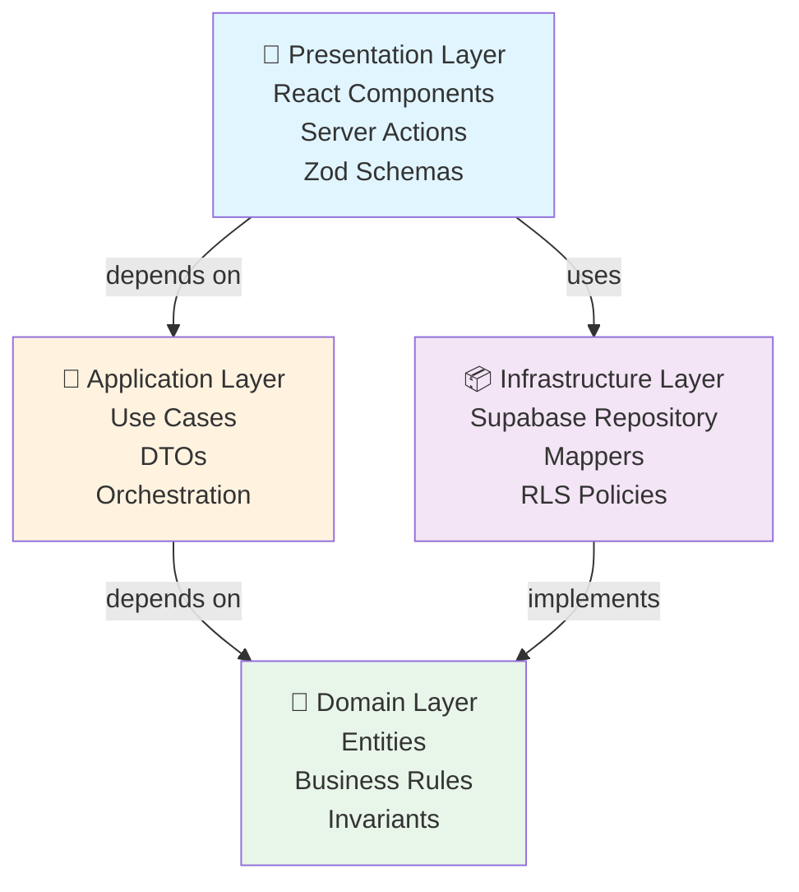
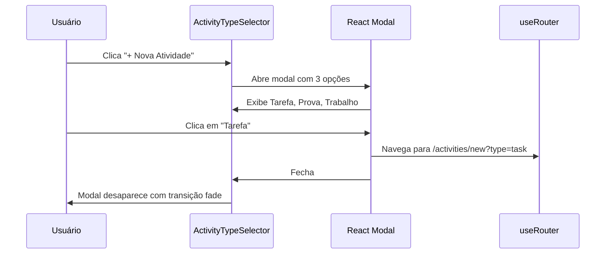
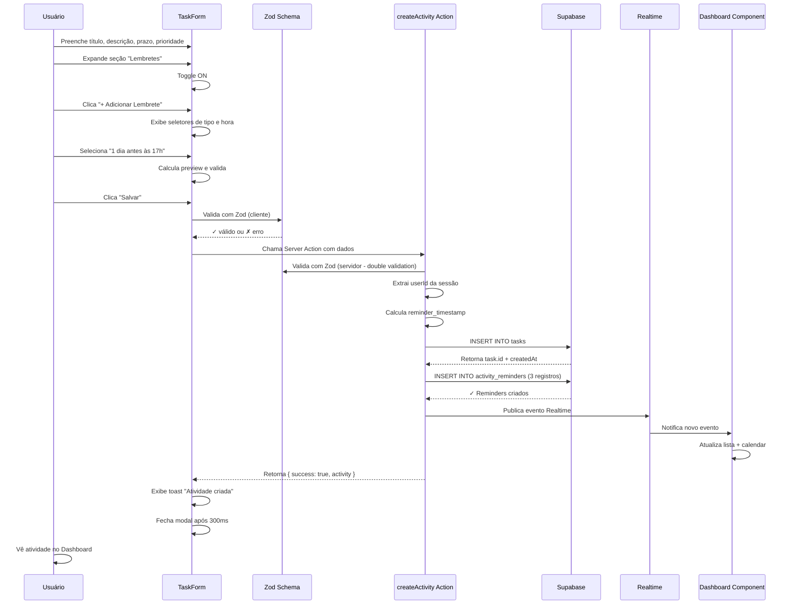
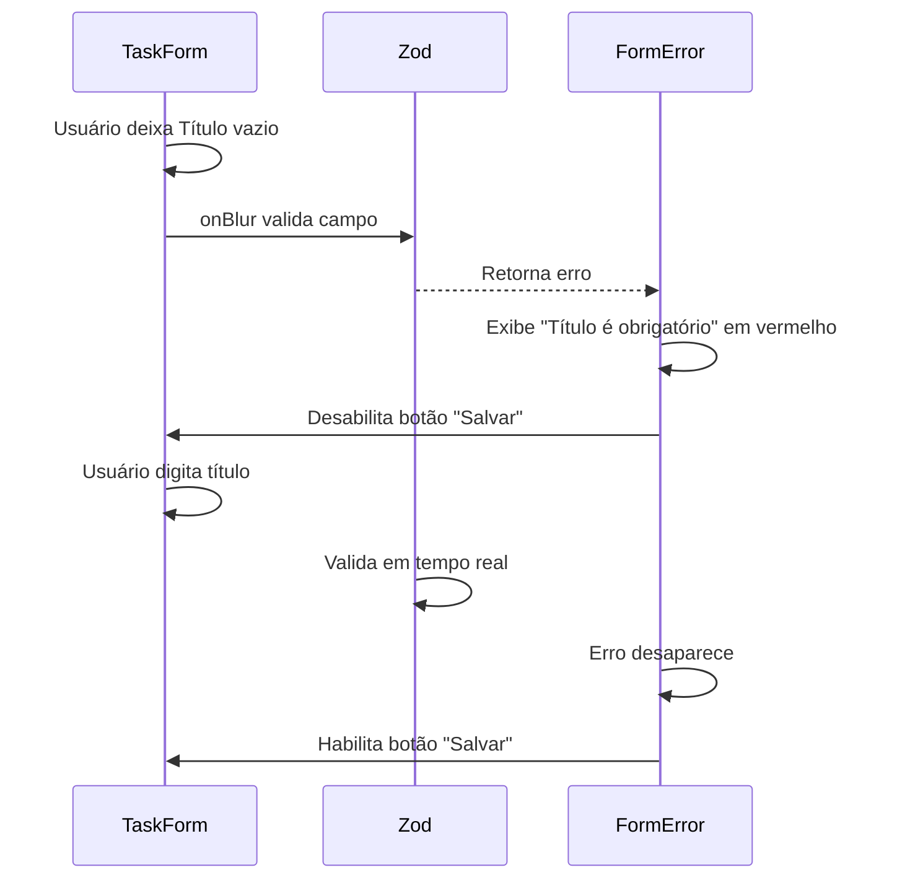
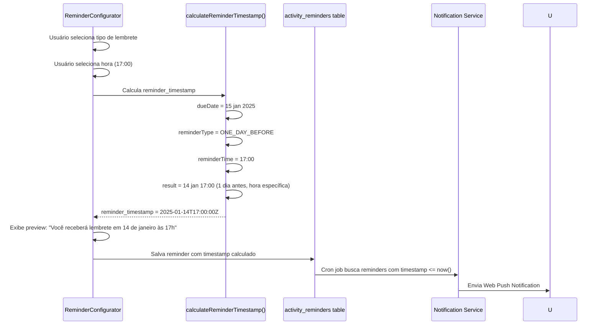
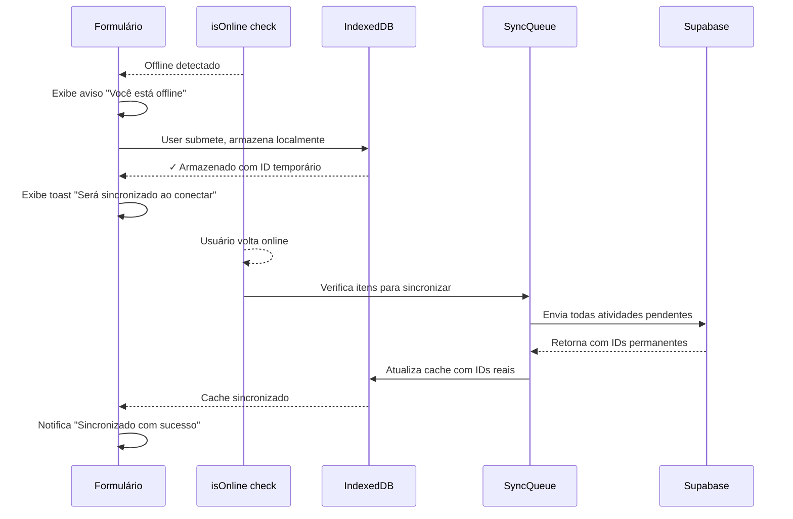

# Design Document: activity-creation

## Visão Geral

A feature **activity-creation** implementa a criação de três tipos de atividades acadêmicas (Tarefa, Prova e Trabalho) com validação rigorosa, sincronização automática em tempo real e suporte a lembretes personalizáveis. Esta é a feature central do MVP, permitindo estudantes estruturarem sua vida acadêmica em um único lugar com criação rápida (< 30 segundos) e orientada por tipo.

A arquitetura segue Clean Architecture com separação clara: Domain (invariantes e regras), Application (casos de uso), Infrastructure (Supabase com RLS), e Presentation (React + Server Actions + Zod). Lembretes são tratados como first-class citizens, permitindo múltiplas notificações personalizadas (máx 3) com timestamps calculados e sincronizados.

---

## Arquitetura em 4 Camadas

### Overview Gráfico



**Fluxo de Dependência:**
- Presentation camada chama Server Actions
- Server Actions chamam Use Cases
- Use Cases usam Domain entities e interfaces
- Infrastructure implementa interfaces do Domain
- Database (Supabase) executa operações com RLS policies

---

## Fluxos Principais com Sequência

### Fluxo 1: Seleção de Tipo de Atividade



**Estados:**
- `closed` - modal não visível
- `open` - modal exibido com 3 opções
- `loading` - aguardando navegação
- `error` - erro ao abrir formulário

---

### Fluxo 2: Criação de Tarefa com Lembretes



---

### Fluxo 3: Validação e Tratamento de Erro



---

### Fluxo 4: Sincronização Realtime entre Visualizações

```mermaid
sequenceDiagram
    participant Create as Atividade Criada
    participant Realtime as Supabase Realtime
    participant Dashboard as Dashboard
    participant Calendar as Calendar
    participant Lists as Task Lists

    Create->>Realtime: Insere novo record
    Realtime->>Realtime: Publica evento INSERT
    
    Realtime->>Dashboard: Notifica subscribers
    Dashboard->>Dashboard: Atualiza query state
    Dashboard->>Dashboard: Re-render com novo item (< 100ms)
    
    Realtime->>Calendar: Notifica subscribers
    Calendar->>Calendar: Recalcula eventos para data
    Calendar->>Calendar: Posiciona evento corretamente
    
    Realtime->>Lists: Notifica subscribers
    Lists->>Lists: Adiciona item à lista apropriada
    
    Dashboard->>Dashboard: Sem flicker/rerender duplo
    Calendar->>Calendar: Animação suave de entrada
    Lists->>Lists: Scroll automático para novo item
```

---

### Fluxo 5: Cálculo e Sincronização de Lembretes



---

### Fluxo 6: Offline-First com IndexedDB



---

## Modelos de Dados (Domain Layer)

### Entity: Activity (Base abstrata)

```typescript
abstract class Activity {
  // Identificação
  id: string                        // UUID, gerado no banco
  userId: string                    // FK para User, garantido por RLS
  
  // Conteúdo básico
  title: string                     // Obrigatório, 1-200 chars
  description?: string              // Opcional, max 2000 chars
  
  // Contexto acadêmico
  subjectId?: string               // FK opcional para Subject
  
  // Timeline
  createdAt: Date                  // Timestamp UTC, auto-set
  updatedAt: Date                  // Timestamp UTC, auto-set
  
  // Métodos de validação
  isValid(): boolean
  validateInvariants(): void
}
```

**Invariantes:**
- `title` nunca vazio
- `userId` sempre presente (auditoria)
- `createdAt` <= `now()`
- `updatedAt` >= `createdAt`
- Não pode deletar atividade criada há > 1 ano (soft-delete)

---

### Entity: Task estendendo Activity

```typescript
class Task extends Activity {
  // Timeline
  dueDate?: Date                   // Optional deadline
  
  // Categorização
  priority: Priority              // enum: LOW, MEDIUM, HIGH (default: MEDIUM)
  status: TaskStatus             // enum: TODO, IN_PROGRESS, COMPLETED (default: TODO)
  
  // Metadata
  estimatedTimeMinutes?: number   // Min 0, max 999
  tags?: string[]                // Array, max 10, each max 50 chars
  
  // Métodos
  markCompleted(): void
  updatePriority(p: Priority): void
  calculateProgressPercent(): number
}
```

**Invariantes específicas:**
- Se `dueDate` definido, deve ser >= hoje
- `priority` sempre um dos 3 valores
- `estimatedTimeMinutes` no range [0, 999]
- Tags únicas (sem duplicatas)

---

### Entity: Exam estendendo Activity

```typescript
class Exam extends Activity {
  // Obrigatórios (Exams requerem disciplina)
  subjectId!: string              // Obrigatório para Exam
  date: Date                      // Exam date, obrigatório
  type: ExamType                  // enum: WRITTEN, ORAL, PRACTICAL
  
  // Opcionais
  time?: string                   // HH:mm format
  content?: string[]              // Topics covered, max 10 items
  location?: string               // Room/location, max 100 chars
  notes?: string                  // Additional notes, max 1000 chars
  
  // Métodos
  getFormattedDate(): string      // "Terça, 15 de janeiro"
  getRemainingDays(): number
}
```

**Invariantes específicas:**
- `subjectId` SEMPRE definido (não null)
- `date` não pode estar no passado
- `type` sempre um dos 3 valores

---

### Entity: Assignment estendendo Activity

```typescript
class Assignment extends Activity {
  // Obrigatórios
  subjectId!: string              // Obrigatório
  dueDate: Date                   // Obrigatório, não no passado
  type: AssignmentType           // enum: WRITTEN, PRESENTATION, PROJECT
  
  // Conteúdo
  description: string             // Obrigatório, 1-3000 chars
  criteria?: string               // Grading criteria, max 2000 chars
  
  // Andamento
  status: AssignmentStatus       // enum: PENDING, SUBMITTED, GRADED (default: PENDING)
  
  // Timeline extra (para Assignment)
  submittedAt?: Date             // Quando foi entregue
  gradedAt?: Date                // Quando foi avaliado
  
  // Métodos
  markSubmitted(): void
  markGraded(): void
  getDaysRemaining(): number
}
```

**Invariantes específicas:**
- `subjectId` SEMPRE definido
- `dueDate` nunca no passado
- Se `status == SUBMITTED`, `submittedAt` deve ser <= `now()`
- Se `status == GRADED`, `gradedAt` deve ser <= `now()`

---

### Entity: Reminder

```typescript
class Reminder {
  id: string                           // UUID
  activityId: string                   // FK para Activity
  userId: string                       // FK para User (RLS)
  
  // Configuração
  reminderType: ReminderType          // enum: ON_DAY, ONE_HOUR_BEFORE, etc, CUSTOM
  reminderOffsetMinutes: number       // Calculated from type, >= 0, <= 43200
  reminderTime: string                // HH:mm, sempre em timezone local do user
  
  // Timestamp calculado
  reminderTimestamp: Date             // Data/hora absoluta da notificação (UTC)
  
  // Estado
  isActive: boolean                   // Default: true
  wasFired?: boolean                  // Se foi disparado
  firedAt?: Date                      // Quando foi disparado
  
  // Auditoria
  createdAt: Date
  updatedAt: Date
  
  // Métodos
  calculateTimestamp(activityDate: Date): Date
  isInPast(): boolean
  markAsFired(): void
}
```

**Invariantes:**
- `reminderTimestamp` < `activity.dueDate` (sempre antes do evento)
- `reminderTimestamp` >= `now()` (nunca no passado)
- Máximo 3 reminders por atividade
- Sem reminders duplicados (mesmo timestamp)

---

### Enums e Tipos

```typescript
enum Priority {
  LOW = "LOW",
  MEDIUM = "MEDIUM",
  HIGH = "HIGH"
}

enum TaskStatus {
  TODO = "TODO",
  IN_PROGRESS = "IN_PROGRESS",
  COMPLETED = "COMPLETED"
}

enum ExamType {
  WRITTEN = "WRITTEN",
  ORAL = "ORAL",
  PRACTICAL = "PRACTICAL"
}

enum AssignmentType {
  WRITTEN = "WRITTEN",
  PRESENTATION = "PRESENTATION",
  PROJECT = "PROJECT"
}

enum AssignmentStatus {
  PENDING = "PENDING",
  SUBMITTED = "SUBMITTED",
  GRADED = "GRADED"
}

enum ReminderType {
  ON_DAY = "ON_DAY",                    // Same day, custom time
  ONE_HOUR_BEFORE = "ONE_HOUR_BEFORE",
  TWO_HOURS_BEFORE = "TWO_HOURS_BEFORE",
  THREE_HOURS_BEFORE = "THREE_HOURS_BEFORE",
  ONE_DAY_BEFORE = "ONE_DAY_BEFORE",
  TWO_DAYS_BEFORE = "TWO_DAYS_BEFORE",
  CUSTOM = "CUSTOM"                     // User-defined offset
}

type ReminderOffset = {
  value: number                         // 1, 2, 3, etc
  unit: "MINUTES" | "HOURS" | "DAYS"
  inMinutes: number                     // Calculated
}
```

---

## Casos de Uso (Application Layer)

### Use Case 1: CreateActivity

**Responsabilidade:** Orquestrar validação, criar atividade no banco com RLS, inserir lembretes, publicar eventos.

```typescript
interface CreateActivityUseCase {
  execute(input: CreateActivityInput): Promise<CreateActivityOutput>
}

interface CreateActivityInput {
  type: 'task' | 'exam' | 'assignment'
  // Campos específicos do tipo
  title?: string
  description?: string
  subjectId?: string
  dueDate?: Date
  priority?: Priority
  status?: TaskStatus
  // ... outros campos conforme tipo
  
  reminders?: ReminderInput[]         // Array de lembretes
}

interface ReminderInput {
  reminderType: ReminderType
  reminderTime: string                // HH:mm
  reminderOffset?: ReminderOffset    // Para CUSTOM
}

interface CreateActivityOutput {
  success: boolean
  activity?: Activity & { reminders: Reminder[] }
  error?: {
    code: string
    message: string
    field?: string
  }
}
```

**Algoritmo:**

```pascal
ALGORITHM CreateActivity
INPUT: createActivityInput
OUTPUT: createActivityOutput

BEGIN
  // Step 1: Validate input structure based on type
  VALIDATE createActivityInput AGAINST schema_for_type
  IF validation fails THEN
    RETURN { success: false, error: validation_error }
  END IF
  
  // Step 2: Extract and validate session
  userId ← getAuthenticatedUserId()
  IF userId is null THEN
    RETURN { success: false, error: "Unauthorized" }
  END IF
  
  // Step 3: Create domain entity
  activity ← CREATE Activity OF type (createActivityInput)
  activity.userId ← userId
  activity.createdAt ← now()
  
  // Step 4: Validate domain invariants
  IF NOT activity.isValid() THEN
    RETURN { success: false, error: domain_error }
  END IF
  
  // Step 5: Calculate reminder timestamps
  IF createActivityInput.reminders THEN
    FOR each reminder_input IN createActivityInput.reminders DO
      reminder ← CREATE Reminder(reminder_input)
      reminder.reminderTimestamp ← calculateTimestamp(activity, reminder)
      
      // Validate reminder is in future
      IF reminder.reminderTimestamp < now() THEN
        RETURN { success: false, error: "Reminder in past" }
      END IF
      
      activity.reminders.add(reminder)
    END FOR
  END IF
  
  // Step 6: Persist to database (with RLS)
  CALL repository.save(activity, userId)
  
  // Step 7: Publish realtime event
  PUBLISH event: { type: "ACTIVITY_CREATED", activity }
  
  // Step 8: Return with generated IDs
  RETURN { success: true, activity }
END
```

**Precondições:**
- Usuário autenticado (session válida)
- Input conforme schema do tipo
- Reminders (se presentes) têm timestamps válidos

**Pós-condições:**
- Atividade inserida no banco com UUID único
- Lembretes associados com timestamp correto
- Evento publicado no Realtime
- Objeto retornado contém activity.id + createdAt

---

### Use Case 2: UpdateActivityReminders

**Responsabilidade:** Atualizar lembretes de atividade existente, recalcular timestamps.

```typescript
interface UpdateActivityRemindersUseCase {
  execute(input: UpdateRemindersInput): Promise<UpdateRemindersOutput>
}

interface UpdateRemindersInput {
  activityId: string
  reminders: ReminderInput[]        // Nova lista de reminders
}

interface UpdateRemindersOutput {
  success: boolean
  activity?: Activity & { reminders: Reminder[] }
  error?: { code: string; message: string }
}
```

**Algoritmo:**

```pascal
ALGORITHM UpdateActivityReminders
INPUT: updateRemindersInput
OUTPUT: updateRemindersOutput

BEGIN
  // Step 1: Validate input
  VALIDATE updateRemindersInput.reminders.length <= 3
  
  // Step 2: Fetch existing activity
  activity ← repository.getActivityById(updateRemindersInput.activityId, userId)
  IF activity is null THEN
    RETURN { success: false, error: "Activity not found" }
  END IF
  
  // Step 3: Calculate new reminders
  newReminders ← []
  FOR each reminder_input IN updateRemindersInput.reminders DO
    reminder ← CREATE Reminder(reminder_input)
    reminder.reminderTimestamp ← calculateTimestamp(activity, reminder)
    newReminders.add(reminder)
  END FOR
  
  // Step 4: Validate no duplicates
  timestamps ← [r.reminderTimestamp for r in newReminders]
  IF hasDuplicates(timestamps) THEN
    RETURN { success: false, error: "Duplicate reminders" }
  END IF
  
  // Step 5: Delete old reminders, insert new
  repository.deleteRemindersByActivityId(activity.id)
  FOR each reminder IN newReminders DO
    repository.saveReminder(reminder)
  END FOR
  
  // Step 6: Publish event
  PUBLISH event: { type: "ACTIVITY_REMINDERS_UPDATED", activity }
  
  RETURN { success: true, activity }
END
```

---

## Implementação Supabase (Infrastructure Layer)

### Schema SQL - Atividades

```sql
-- Activities base table
CREATE TABLE activities (
  id UUID PRIMARY KEY DEFAULT gen_random_uuid(),
  user_id UUID NOT NULL REFERENCES auth.users(id) ON DELETE CASCADE,
  type VARCHAR(20) NOT NULL CHECK (type IN ('TASK', 'EXAM', 'ASSIGNMENT')),
  
  -- Common fields
  title VARCHAR(200) NOT NULL,
  description TEXT,
  subject_id UUID REFERENCES subjects(id) ON DELETE SET NULL,
  
  -- Timestamps
  created_at TIMESTAMP WITH TIME ZONE DEFAULT now() NOT NULL,
  updated_at TIMESTAMP WITH TIME ZONE DEFAULT now() NOT NULL,
  
  -- For optimistic UI updates
  synced BOOLEAN DEFAULT false,
  
  CONSTRAINT check_no_empty_title CHECK (length(trim(title)) > 0)
);

-- Indexes para performance
CREATE INDEX idx_activities_user_id ON activities(user_id);
CREATE INDEX idx_activities_user_created ON activities(user_id, created_at DESC);
CREATE INDEX idx_activities_user_subject ON activities(user_id, subject_id);
CREATE INDEX idx_activities_type ON activities(type);

-- Auto-update updated_at
CREATE TRIGGER update_activities_updated_at
  BEFORE UPDATE ON activities
  FOR EACH ROW
  EXECUTE FUNCTION update_timestamp();

-- Tasks table (specialization)
CREATE TABLE tasks (
  id UUID PRIMARY KEY REFERENCES activities(id) ON DELETE CASCADE,
  
  due_date DATE,
  due_time TIME,
  priority VARCHAR(10) NOT NULL DEFAULT 'MEDIUM'
    CHECK (priority IN ('LOW', 'MEDIUM', 'HIGH')),
  status VARCHAR(20) NOT NULL DEFAULT 'TODO'
    CHECK (status IN ('TODO', 'IN_PROGRESS', 'COMPLETED')),
  
  estimated_time_minutes INTEGER CHECK (estimated_time_minutes >= 0 AND estimated_time_minutes <= 999),
  tags TEXT[] DEFAULT ARRAY[]::TEXT[],
  
  CHECK (priority IS NOT NULL),
  CHECK (status IS NOT NULL)
);

-- Exams table (specialization)
CREATE TABLE exams (
  id UUID PRIMARY KEY REFERENCES activities(id) ON DELETE CASCADE,
  
  date DATE NOT NULL,
  time TIME,
  exam_type VARCHAR(20) NOT NULL
    CHECK (exam_type IN ('WRITTEN', 'ORAL', 'PRACTICAL')),
  content TEXT[] DEFAULT ARRAY[]::TEXT[],
  location VARCHAR(100),
  notes TEXT CHECK (length(notes) <= 1000),
  
  CONSTRAINT exam_date_not_past CHECK (date >= CURRENT_DATE),
  CONSTRAINT exam_type_required CHECK (exam_type IS NOT NULL)
);

-- Assignments table (specialization)
CREATE TABLE assignments (
  id UUID PRIMARY KEY REFERENCES activities(id) ON DELETE CASCADE,
  
  due_date DATE NOT NULL,
  due_time TIME,
  assignment_type VARCHAR(20) NOT NULL
    CHECK (assignment_type IN ('WRITTEN', 'PRESENTATION', 'PROJECT')),
  criteria TEXT CHECK (length(criteria) <= 2000),
  status VARCHAR(20) NOT NULL DEFAULT 'PENDING'
    CHECK (status IN ('PENDING', 'SUBMITTED', 'GRADED')),
  
  submitted_at TIMESTAMP WITH TIME ZONE,
  graded_at TIMESTAMP WITH TIME ZONE,
  
  CONSTRAINT assignment_date_not_past CHECK (due_date >= CURRENT_DATE),
  CONSTRAINT assignment_type_required CHECK (assignment_type IS NOT NULL)
);

-- Activity Reminders table
CREATE TABLE activity_reminders (
  id UUID PRIMARY KEY DEFAULT gen_random_uuid(),
  activity_id UUID NOT NULL REFERENCES activities(id) ON DELETE CASCADE,
  user_id UUID NOT NULL REFERENCES auth.users(id) ON DELETE CASCADE,
  
  -- Reminder configuration
  reminder_type VARCHAR(30) NOT NULL
    CHECK (reminder_type IN ('ON_DAY', 'ONE_HOUR_BEFORE', 'TWO_HOURS_BEFORE', 'THREE_HOURS_BEFORE', 'ONE_DAY_BEFORE', 'TWO_DAYS_BEFORE', 'CUSTOM')),
  reminder_offset_minutes INTEGER NOT NULL CHECK (reminder_offset_minutes >= 0 AND reminder_offset_minutes <= 43200),
  reminder_time TIME NOT NULL,  -- HH:mm in user's timezone
  
  -- Absolute timestamp (when to fire the reminder)
  reminder_timestamp TIMESTAMP WITH TIME ZONE NOT NULL,
  
  -- State
  is_active BOOLEAN DEFAULT true,
  was_fired BOOLEAN DEFAULT false,
  fired_at TIMESTAMP WITH TIME ZONE,
  
  -- Audit
  created_at TIMESTAMP WITH TIME ZONE DEFAULT now() NOT NULL,
  updated_at TIMESTAMP WITH TIME ZONE DEFAULT now() NOT NULL,
  
  CONSTRAINT reminder_before_event CHECK (reminder_timestamp > created_at),
  CONSTRAINT reminder_not_past CHECK (reminder_timestamp >= now()),
  CONSTRAINT reminder_time_valid CHECK (reminder_time >= '00:00'::TIME AND reminder_time <= '23:59'::TIME)
);

-- Indexes
CREATE INDEX idx_reminders_user_id ON activity_reminders(user_id);
CREATE INDEX idx_reminders_activity_id ON activity_reminders(activity_id);
CREATE INDEX idx_reminders_timestamp ON activity_reminders(reminder_timestamp);
CREATE INDEX idx_reminders_fire_pending ON activity_reminders(reminder_timestamp)
  WHERE is_active = true AND was_fired = false;

-- Auto-update trigger
CREATE TRIGGER update_reminders_updated_at
  BEFORE UPDATE ON activity_reminders
  FOR EACH ROW
  EXECUTE FUNCTION update_timestamp();
```

### RLS Policies

```sql
-- Activities: Usuários veem apenas suas atividades
CREATE POLICY "Users see their own activities"
  ON activities FOR SELECT
  USING (auth.uid() = user_id);

CREATE POLICY "Users insert their own activities"
  ON activities FOR INSERT
  WITH CHECK (auth.uid() = user_id);

CREATE POLICY "Users update their own activities"
  ON activities FOR UPDATE
  USING (auth.uid() = user_id)
  WITH CHECK (auth.uid() = user_id);

CREATE POLICY "Users delete their own activities"
  ON activities FOR DELETE
  USING (auth.uid() = user_id);

-- Tasks: Herda de activities via FK
CREATE POLICY "Users see their own tasks"
  ON tasks FOR SELECT
  USING (EXISTS (
    SELECT 1 FROM activities
    WHERE activities.id = tasks.id
    AND activities.user_id = auth.uid()
  ));

-- Exams: Similar a tasks
CREATE POLICY "Users see their own exams"
  ON exams FOR SELECT
  USING (EXISTS (
    SELECT 1 FROM activities
    WHERE activities.id = exams.id
    AND activities.user_id = auth.uid()
  ));

-- Assignments: Similar a tasks
CREATE POLICY "Users see their own assignments"
  ON assignments FOR SELECT
  USING (EXISTS (
    SELECT 1 FROM activities
    WHERE activities.id = assignments.id
    AND activities.user_id = auth.uid()
  ));

-- Reminders: Usuários veem apenas seus próprios reminders
CREATE POLICY "Users see their own reminders"
  ON activity_reminders FOR SELECT
  USING (auth.uid() = user_id);

CREATE POLICY "Users insert their own reminders"
  ON activity_reminders FOR INSERT
  WITH CHECK (auth.uid() = user_id);

CREATE POLICY "Users update their own reminders"
  ON activity_reminders FOR UPDATE
  USING (auth.uid() = user_id)
  WITH CHECK (auth.uid() = user_id);

CREATE POLICY "Users delete their own reminders"
  ON activity_reminders FOR DELETE
  USING (auth.uid() = user_id);

-- Enable RLS
ALTER TABLE activities ENABLE ROW LEVEL SECURITY;
ALTER TABLE tasks ENABLE ROW LEVEL SECURITY;
ALTER TABLE exams ENABLE ROW LEVEL SECURITY;
ALTER TABLE assignments ENABLE ROW LEVEL SECURITY;
ALTER TABLE activity_reminders ENABLE ROW LEVEL SECURITY;
```

---

## Componentes React (Presentation Layer)

### Componente: ActivityTypeSelector

**Props:**
```typescript
interface ActivityTypeSelectorProps {
  onSelectType: (type: 'task' | 'exam' | 'assignment') => void
  onClose: () => void
  isOpen: boolean
}
```

**Comportamento:**
- Exibe modal com 3 cards: Tarefa, Prova, Trabalho
- Cada card tem ícone, título e breve descrição
- Click em card navega para formulário específico
- Click fora ou ESC fecha modal
- Transição suave de entrada/saída (fade + scale)

```typescript
export function ActivityTypeSelector({ onSelectType, onClose, isOpen }: ActivityTypeSelectorProps) {
  useEffect(() => {
    const handleEscape = (e: KeyboardEvent) => {
      if (e.key === 'Escape') onClose()
    }
    window.addEventListener('keydown', handleEscape)
    return () => window.removeEventListener('keydown', handleEscape)
  }, [onClose])

  return (
    <Dialog open={isOpen} onOpenChange={onClose}>
      <DialogContent className="max-w-md">
        <DialogHeader>
          <DialogTitle>Nova Atividade</DialogTitle>
        </DialogHeader>
        
        <div className="grid gap-3">
          {/* Tarefa */}
          <button
            onClick={() => onSelectType('task')}
            className="p-4 border rounded-lg hover:bg-blue-50 transition"
          >
            <CheckCircle2 className="w-6 h-6 mb-2" />
            <div className="font-semibold">Tarefa</div>
            <div className="text-sm text-gray-500">Estude, revise, faça exercícios</div>
          </button>
          
          {/* Prova */}
          <button
            onClick={() => onSelectType('exam')}
            className="p-4 border rounded-lg hover:bg-purple-50 transition"
          >
            <FileText className="w-6 h-6 mb-2" />
            <div className="font-semibold">Prova</div>
            <div className="text-sm text-gray-500">Avaliação em disciplina</div>
          </button>
          
          {/* Trabalho */}
          <button
            onClick={() => onSelectType('assignment')}
            className="p-4 border rounded-lg hover:bg-green-50 transition"
          >
            <BookOpen className="w-6 h-6 mb-2" />
            <div className="font-semibold">Trabalho</div>
            <div className="text-sm text-gray-500">Entrega com critérios</div>
          </button>
        </div>
      </DialogContent>
    </Dialog>
  )
}
```

---

### Componente: TaskForm

**Props:**
```typescript
interface TaskFormProps {
  onSuccess?: (task: Task) => void
  onError?: (error: string) => void
  initialValues?: Partial<Task>
}
```

**Campos:**
- `title` (text, obrigatório, max 200)
- `description` (textarea, optional, max 2000, com contador)
- `subjectId` (select, optional, carregado dinamicamente)
- `dueDate` (date picker, optional, desabilita passado)
- `dueTime` (time picker, optional)
- `priority` (radio: LOW, MEDIUM, HIGH)
- `status` (radio: TODO, IN_PROGRESS, COMPLETED)
- `estimatedTimeMinutes` (number, optional, 0-999)
- `tags` (autocomplete, optional, max 10)
- Seção "Lembretes" expandível com `ReminderConfigurator`

**Comportamento:**
- Validação em tempo real onBlur
- Desabilita "Salvar" se campos obrigatórios vazios
- Loading spinner no botão durante submit
- Toast de sucesso com actions rápidas
- Mantém dados se erro, exibe mensagem

```typescript
export function TaskForm({ onSuccess, onError, initialValues }: TaskFormProps) {
  const form = useForm<CreateTaskInput>({
    resolver: zodResolver(createTaskSchema),
    defaultValues: initialValues || {
      priority: 'MEDIUM',
      status: 'TODO',
      reminders: []
    }
  })

  const [isLoading, setIsLoading] = useState(false)
  const [subjects, setSubjects] = useState<Subject[]>([])
  const [showReminders, setShowReminders] = useState(false)

  // Carregar disciplinas ao montar
  useEffect(() => {
    async function loadSubjects() {
      const result = await getSubjectsAction()
      if (result.success) {
        setSubjects(result.data)
      }
    }
    loadSubjects()
  }, [])

  async function onSubmit(data: CreateTaskInput) {
    setIsLoading(true)
    try {
      const result = await createActivityAction({
        type: 'task',
        ...data
      })

      if (result.success) {
        toast.success('Tarefa criada com sucesso', {
          action: <Button onClick={() => router.push(`/activities/${result.activity.id}`)}>
            Abrir
          </Button>
        })
        onSuccess?.(result.activity)
      } else {
        const message = result.error?.message || 'Erro ao criar tarefa'
        toast.error(message)
        onError?.(message)
      }
    } finally {
      setIsLoading(false)
    }
  }

  return (
    <form onSubmit={form.handleSubmit(onSubmit)} className="space-y-6">
      {/* Campo: Título */}
      <FormField
        label="Título"
        required
        error={form.formState.errors.title?.message}
      >
        <input
          {...form.register('title')}
          placeholder="Ex: Estudar Cálculo II"
          maxLength={200}
          className="w-full px-3 py-2 border rounded-md"
        />
        <span className="text-xs text-gray-500">
          {form.watch('title')?.length || 0}/200
        </span>
      </FormField>

      {/* Campo: Descrição */}
      <FormField
        label="Descrição"
        error={form.formState.errors.description?.message}
      >
        <textarea
          {...form.register('description')}
          placeholder="Detalhes..."
          maxLength={2000}
          rows={4}
          className="w-full px-3 py-2 border rounded-md"
        />
        <span className="text-xs text-gray-500">
          {form.watch('description')?.length || 0}/2000
        </span>
      </FormField>

      {/* Campo: Disciplina */}
      <FormField
        label="Disciplina"
        error={form.formState.errors.subjectId?.message}
      >
        <select
          {...form.register('subjectId')}
          className="w-full px-3 py-2 border rounded-md"
        >
          <option value="">Sem disciplina</option>
          {subjects.map(s => (
            <option key={s.id} value={s.id}>{s.name}</option>
          ))}
        </select>
      </FormField>

      {/* Campo: Prazo */}
      <FormField
        label="Prazo"
        error={form.formState.errors.dueDate?.message}
      >
        <input
          type="date"
          {...form.register('dueDate', { valueAsDate: true })}
          min={format(new Date(), 'yyyy-MM-dd')}
          className="w-full px-3 py-2 border rounded-md"
        />
      </FormField>

      {/* Campo: Hora */}
      {form.watch('dueDate') && (
        <FormField label="Hora">
          <input
            type="time"
            {...form.register('dueTime')}
            className="w-full px-3 py-2 border rounded-md"
          />
        </FormField>
      )}

      {/* Campo: Prioridade */}
      <FormField
        label="Prioridade"
        required
        error={form.formState.errors.priority?.message}
      >
        <div className="space-y-2">
          {['LOW', 'MEDIUM', 'HIGH'].map(p => (
            <label key={p} className="flex items-center gap-2">
              <input
                type="radio"
                value={p}
                {...form.register('priority')}
              />
              <span>{p === 'LOW' ? 'Baixa' : p === 'MEDIUM' ? 'Média' : 'Alta'}</span>
            </label>
          ))}
        </div>
      </FormField>

      {/* Seção: Lembretes */}
      <div className="border rounded-lg p-4">
        <button
          type="button"
          onClick={() => setShowReminders(!showReminders)}
          className="flex items-center gap-2 w-full font-semibold"
        >
          <ChevronDown className={`w-4 h-4 ${showReminders ? 'rotate-180' : ''}`} />
          Lembretes
        </button>
        
        {showReminders && (
          <div className="mt-4">
            <ReminderConfigurator
              reminders={form.watch('reminders')}
              onUpdate={(reminders) => form.setValue('reminders', reminders)}
              activityDueDate={form.watch('dueDate')}
            />
          </div>
        )}
      </div>

      {/* Botão: Salvar */}
      <Button
        type="submit"
        disabled={isLoading || !form.formState.isValid}
        className="w-full"
      >
        {isLoading ? 'Salvando...' : 'Salvar Tarefa'}
      </Button>
    </form>
  )
}
```

---

### Componente: ReminderConfigurator (Reutilizável)

**Props:**
```typescript
interface ReminderConfiguratorProps {
  reminders: ReminderInput[]
  onUpdate: (reminders: ReminderInput[]) => void
  activityDueDate: Date | undefined
  maxReminders?: number  // default 3
}
```

**Comportamento:**
- Toggle: "Receber lembrete?"
- Se ON: exibir lista de reminders e botão "+ Adicionar"
- Cada reminder mostra: tipo, hora, preview, delete
- Validação em tempo real (hora inválida, no passado, duplicada)
- Preview legível: "Você receberá lembrete em 14 de janeiro às 17h"

```typescript
export function ReminderConfigurator({
  reminders,
  onUpdate,
  activityDueDate,
  maxReminders = 3
}: ReminderConfiguratorProps) {
  const [showForm, setShowForm] = useState(false)
  const [newReminder, setNewReminder] = useState<Partial<ReminderInput>>({
    reminderType: 'ONE_HOUR_BEFORE'
  })

  const canAddMore = reminders.length < maxReminders

  function addReminder() {
    if (!newReminder.reminderType || !newReminder.reminderTime) {
      toast.error('Preencha tipo e hora')
      return
    }

    if (!activityDueDate) {
      toast.error('Defina a data da atividade primeiro')
      return
    }

    // Calcular timestamp do lembrete
    const reminderDate = calculateReminderTimestamp(
      activityDueDate,
      newReminder.reminderType as ReminderType,
      newReminder.reminderTime!,
      newReminder.reminderOffset
    )

    // Validar não está no passado
    if (reminderDate < new Date()) {
      toast.error('Lembrete não pode estar no passado')
      return
    }

    // Validar não é duplicado
    if (reminders.some(r => 
      r.reminderTime === newReminder.reminderTime && 
      r.reminderType === newReminder.reminderType
    )) {
      toast.error('Este lembrete já foi adicionado')
      return
    }

    // Adicionar
    onUpdate([...reminders, newReminder as ReminderInput])
    setNewReminder({ reminderType: 'ONE_HOUR_BEFORE' })
    setShowForm(false)
  }

  function deleteReminder(index: number) {
    onUpdate(reminders.filter((_, i) => i !== index))
  }

  function getReminderPreview(reminder: ReminderInput, dueDate: Date): string {
    const reminderDateTime = calculateReminderTimestamp(
      dueDate,
      reminder.reminderType as ReminderType,
      reminder.reminderTime,
      reminder.reminderOffset
    )
    return `Lembrete em ${format(reminderDateTime, "dd 'de' MMMM 'às' HH:mm", { locale: ptBR })}`
  }

  return (
    <div className="space-y-4">
      {/* Toggle ON/OFF */}
      <div className="flex items-center gap-2">
        <Checkbox
          checked={reminders.length > 0}
          onCheckedChange={(checked) => {
            if (!checked) {
              onUpdate([])
            }
          }}
        />
        <span>Receber lembrete?</span>
      </div>

      {/* Lista de reminders existentes */}
      {reminders.length > 0 && (
        <div className="space-y-2">
          {reminders.map((reminder, idx) => (
            <div
              key={idx}
              className="flex items-center justify-between p-3 bg-blue-50 rounded-lg border border-blue-200"
            >
              <span className="text-sm">
                {activityDueDate ? getReminderPreview(reminder, activityDueDate) : 'Aguardando data'}
              </span>
              <Button
                type="button"
                variant="ghost"
                size="sm"
                onClick={() => deleteReminder(idx)}
              >
                <X className="w-4 h-4" />
              </Button>
            </div>
          ))}
          <span className="text-xs text-gray-500">
            {reminders.length}/{maxReminders} lembretes
          </span>
        </div>
      )}

      {/* Botão para adicionar novo */}
      {canAddMore && !showForm && (
        <Button
          type="button"
          variant="outline"
          onClick={() => setShowForm(true)}
          className="w-full"
        >
          + Adicionar Lembrete
        </Button>
      )}

      {/* Formulário para novo lembrete */}
      {showForm && (
        <div className="space-y-3 p-3 bg-gray-50 rounded-lg border">
          {/* Select: Tipo de lembrete */}
          <div>
            <label className="text-sm font-medium">Quando?</label>
            <select
              value={newReminder.reminderType || ''}
              onChange={(e) => setNewReminder({ ...newReminder, reminderType: e.target.value })}
              className="w-full px-3 py-2 border rounded-md text-sm"
            >
              <option value="ON_DAY">No dia do evento</option>
              <option value="ONE_HOUR_BEFORE">1 hora antes</option>
              <option value="TWO_HOURS_BEFORE">2 horas antes</option>
              <option value="THREE_HOURS_BEFORE">3 horas antes</option>
              <option value="ONE_DAY_BEFORE">1 dia antes</option>
              <option value="TWO_DAYS_BEFORE">2 dias antes</option>
              <option value="CUSTOM">Personalizado</option>
            </select>
          </div>

          {/* Se CUSTOM, mostrar inputs de offset */}
          {newReminder.reminderType === 'CUSTOM' && (
            <div className="flex gap-2">
              <input
                type="number"
                placeholder="Qtd"
                min="1"
                max="30"
                className="flex-1 px-3 py-2 border rounded-md text-sm"
                onChange={(e) => setNewReminder({
                  ...newReminder,
                  reminderOffset: { value: parseInt(e.target.value) }
                })}
              />
              <select
                className="flex-1 px-3 py-2 border rounded-md text-sm"
                onChange={(e) => setNewReminder({
                  ...newReminder,
                  reminderOffset: {
                    ...newReminder.reminderOffset,
                    unit: e.target.value as 'MINUTES' | 'HOURS' | 'DAYS'
                  }
                })}
              >
                <option value="MINUTES">Minutos</option>
                <option value="HOURS">Horas</option>
                <option value="DAYS">Dias</option>
              </select>
            </div>
          )}

          {/* Time picker: Hora */}
          <div>
            <label className="text-sm font-medium">Que horas?</label>
            <input
              type="time"
              value={newReminder.reminderTime || ''}
              onChange={(e) => setNewReminder({ ...newReminder, reminderTime: e.target.value })}
              className="w-full px-3 py-2 border rounded-md text-sm"
            />
          </div>

          {/* Preview */}
          {activityDueDate && newReminder.reminderTime && (
            <p className="text-xs text-gray-600">
              {getReminderPreview(newReminder as ReminderInput, activityDueDate)}
            </p>
          )}

          {/* Buttons */}
          <div className="flex gap-2 justify-end">
            <Button
              type="button"
              variant="outline"
              size="sm"
              onClick={() => setShowForm(false)}
            >
              Cancelar
            </Button>
            <Button
              type="button"
              size="sm"
              onClick={addReminder}
            >
              Adicionar
            </Button>
          </div>
        </div>
      )}
    </div>
  )
}
```

---

## Server Actions (Presentation Layer)

### Server Action: createActivity

**Arquivo:** `/src/features/activities/presentation/actions/createActivity.ts`

```typescript
'use server'

import { z } from 'zod'
import { createActivitySchema } from '../schemas/createActivitySchema'
import { createActivityUseCase } from '../../application/useCases/createActivity'
import { getCurrentUser } from '@/shared/lib/auth/helpers'

export async function createActivityAction(input: unknown) {
  try {
    // 1. Validar input com Zod (cliente já validou, mas validar novamente)
    const validatedInput = createActivitySchema.parse(input)

    // 2. Obter usuário autenticado
    const user = await getCurrentUser()
    if (!user) {
      return {
        success: false,
        error: {
          code: 'UNAUTHORIZED',
          message: 'Usuário não autenticado'
        }
      }
    }

    // 3. Chamar use case
    const result = await createActivityUseCase.execute({
      ...validatedInput,
      userId: user.id
    })

    if (!result.success) {
      return {
        success: false,
        error: result.error
      }
    }

    // 4. Retornar sucesso com atividade criada
    return {
      success: true,
      activity: result.activity
    }

  } catch (error) {
    // Capturar erros de validação Zod
    if (error instanceof z.ZodError) {
      return {
        success: false,
        error: {
          code: 'VALIDATION_ERROR',
          message: error.errors[0].message,
          field: error.errors[0].path.join('.')
        }
      }
    }

    // Erros genéricos
    console.error('[createActivity] Error:', error)
    return {
      success: false,
      error: {
        code: 'INTERNAL_ERROR',
        message: 'Erro ao criar atividade. Tente novamente.'
      }
    }
  }
}
```

---

## Schemas Zod (Presentation Layer)

### Main Schemas

**Arquivo:** `/src/features/activities/presentation/schemas/createActivitySchema.ts`

```typescript
import { z } from 'zod'
import { reminderSchema } from './reminderSchema'

export const createTaskSchema = z.object({
  type: z.literal('task'),
  title: z.string()
    .min(1, 'Título é obrigatório')
    .max(200, 'Máximo 200 caracteres'),
  description: z.string()
    .max(2000, 'Máximo 2000 caracteres')
    .optional(),
  subjectId: z.string().uuid().optional(),
  dueDate: z.coerce.date()
    .refine(d => d >= new Date(), 'Data não pode estar no passado')
    .optional(),
  dueTime: z.string()
    .regex(/^\d{2}:\d{2}$/, 'Formato HH:mm')
    .optional(),
  priority: z.enum(['LOW', 'MEDIUM', 'HIGH']).default('MEDIUM'),
  status: z.enum(['TODO', 'IN_PROGRESS', 'COMPLETED']).default('TODO'),
  estimatedTimeMinutes: z.number()
    .min(0)
    .max(999)
    .optional(),
  tags: z.array(z.string().max(50)).max(10).optional(),
  reminders: z.array(reminderSchema).max(3).optional()
})

export const createExamSchema = z.object({
  type: z.literal('exam'),
  subjectId: z.string().uuid('Selecione uma disciplina'),
  date: z.coerce.date()
    .refine(d => d >= new Date(), 'Data não pode estar no passado'),
  time: z.string()
    .regex(/^\d{2}:\d{2}$/, 'Formato HH:mm')
    .optional(),
  examType: z.enum(['WRITTEN', 'ORAL', 'PRACTICAL']),
  content: z.array(z.string()).max(10).optional(),
  location: z.string().max(100).optional(),
  notes: z.string().max(1000).optional(),
  reminders: z.array(reminderSchema).max(3).optional()
})

export const createAssignmentSchema = z.object({
  type: z.literal('assignment'),
  subjectId: z.string().uuid('Selecione uma disciplina'),
  title: z.string()
    .min(1, 'Título é obrigatório')
    .max(200, 'Máximo 200 caracteres'),
  description: z.string()
    .min(1, 'Descrição é obrigatória')
    .max(3000, 'Máximo 3000 caracteres'),
  dueDate: z.coerce.date()
    .refine(d => d >= new Date(), 'Data não pode estar no passado'),
  dueTime: z.string()
    .regex(/^\d{2}:\d{2}$/, 'Formato HH:mm')
    .optional(),
  assignmentType: z.enum(['WRITTEN', 'PRESENTATION', 'PROJECT']),
  criteria: z.string().max(2000).optional(),
  status: z.enum(['PENDING', 'SUBMITTED', 'GRADED']).default('PENDING'),
  reminders: z.array(reminderSchema).max(3).optional()
})

export const createActivitySchema = z.discriminatedUnion('type', [
  createTaskSchema,
  createExamSchema,
  createAssignmentSchema
])

export type CreateActivityInput = z.infer<typeof createActivitySchema>
```

### Reminder Schema

**Arquivo:** `/src/features/activities/presentation/schemas/reminderSchema.ts`

```typescript
import { z } from 'zod'

export const reminderSchema = z.object({
  reminderType: z.enum([
    'ON_DAY',
    'ONE_HOUR_BEFORE',
    'TWO_HOURS_BEFORE',
    'THREE_HOURS_BEFORE',
    'ONE_DAY_BEFORE',
    'TWO_DAYS_BEFORE',
    'CUSTOM'
  ]),
  reminderTime: z.string()
    .regex(/^\d{2}:\d{2}$/, 'Formato HH:mm inválido')
    .refine(time => {
      const [hours, minutes] = time.split(':').map(Number)
      return hours >= 0 && hours <= 23 && minutes >= 0 && minutes <= 59
    }, 'Hora deve estar entre 00:00 e 23:59'),
  reminderOffset: z.object({
    value: z.number().min(1).max(30),
    unit: z.enum(['MINUTES', 'HOURS', 'DAYS'])
  }).optional()
})
  .refine(
    (data) => data.reminderType !== 'CUSTOM' || data.reminderOffset,
    'Offset é obrigatório para lembretes customizados'
  )

export type ReminderInput = z.infer<typeof reminderSchema>
```

---

## Integração Realtime (Sincronização)

**Arquivo:** `/src/features/activities/presentation/hooks/useActivityRealtime.ts`

```typescript
import { useEffect } from 'react'
import { supabase } from '@/shared/lib/supabase/client'
import { useQueryClient } from '@tanstack/react-query'

export function useActivityRealtime(userId: string | undefined) {
  const queryClient = useQueryClient()

  useEffect(() => {
    if (!userId) return

    // Subscribe ao canal de atividades do usuário
    const channel = supabase.channel(`activities:${userId}`)
      .on(
        'postgres_changes',
        {
          event: '*',  // INSERT, UPDATE, DELETE
          schema: 'public',
          table: 'activities',
          filter: `user_id=eq.${userId}`
        },
        (payload) => {
          // Invalidar queries relacionadas para re-fetch automático
          queryClient.invalidateQueries({
            queryKey: ['activities', userId]
          })
          queryClient.invalidateQueries({
            queryKey: ['calendar', userId]
          })

          // Publicar evento para components subscritos
          window.dispatchEvent(new CustomEvent('activity:changed', {
            detail: { event: payload.eventType, data: payload.new }
          }))
        }
      )
      .subscribe()

    // Cleanup
    return () => {
      supabase.removeChannel(channel)
    }
  }, [userId, queryClient])
}
```

---

## Offline-First com IndexedDB

**Arquivo:** `/src/features/activities/presentation/lib/offlineSync.ts`

```typescript
import Dexie, { Table } from 'dexie'

class ActivityDatabase extends Dexie {
  activities!: Table<Activity>
  syncQueue!: Table<SyncQueueItem>

  constructor() {
    super('AmandaActivityDB')
    this.version(1).stores({
      activities: 'id, userId, createdAt',
      syncQueue: '++id, activityId, status'
    })
  }
}

export const activityDB = new ActivityDatabase()

export interface SyncQueueItem {
  id?: number
  activityId: string
  type: 'CREATE' | 'UPDATE' | 'DELETE'
  data: any
  status: 'PENDING' | 'SYNCED' | 'FAILED'
  retries: number
  createdAt: Date
}

export async function saveActivityOffline(activity: Activity) {
  try {
    await activityDB.activities.add(activity)
    await activityDB.syncQueue.add({
      activityId: activity.id,
      type: 'CREATE',
      data: activity,
      status: 'PENDING',
      retries: 0,
      createdAt: new Date()
    })
    return true
  } catch (error) {
    console.error('Error saving to IndexedDB:', error)
    return false
  }
}

export async function syncPendingActivities(userId: string) {
  const pending = await activityDB.syncQueue
    .where('status')
    .equals('PENDING')
    .toArray()

  for (const item of pending) {
    try {
      if (item.type === 'CREATE') {
        await createActivityAction(item.data)
        await activityDB.syncQueue.update(item.id!, {
          status: 'SYNCED'
        })
      }
    } catch (error) {
      item.retries++
      if (item.retries > 3) {
        await activityDB.syncQueue.update(item.id!, {
          status: 'FAILED'
        })
      }
    }
  }
}

// Chamar ao conectar
window.addEventListener('online', async () => {
  const user = await getCurrentUser()
  if (user) {
    await syncPendingActivities(user.id)
  }
})
```

---

## Tratamento de Erros Específicos

**Arquivo:** `/src/features/activities/application/errorHandler.ts`

```typescript
export class ActivityError extends Error {
  constructor(
    public code: string,
    message: string,
    public statusCode: number = 400
  ) {
    super(message)
    this.name = 'ActivityError'
  }
}

export function handleSupabaseError(error: any): ActivityError {
  const message = error.message || 'Erro ao conectar com servidor'

  // RLS Policy violation
  if (error.code === 'PGRST301') {
    return new ActivityError(
      'FORBIDDEN',
      'Você não tem permissão para criar esta atividade',
      403
    )
  }

  // Quota excedido (constraint violation)
  if (error.code === '23505') {
    return new ActivityError(
      'QUOTA_EXCEEDED',
      'Limite de atividades atingido. Considere arquivar antigas.',
      400
    )
  }

  // Field validation
  if (error.code === '23514') {
    return new ActivityError(
      'VALIDATION_ERROR',
      'Dados inválidos. Revise o formulário.',
      400
    )
  }

  // Default
  return new ActivityError(
    'INTERNAL_ERROR',
    'Erro ao criar atividade. Tente novamente.',
    500
  )
}
```

---

## Performance & Timing

### Métricas Alvo

| Métrica | Alvo | Como Medir |
|---------|------|-----------|
| Criação de Tarefa | < 30s | Performance tab (Network + JavaScript) |
| Criação de Prova | < 30s | Performance tab |
| Criação de Trabalho | < 30s | Performance tab |
| Sincronização Realtime | < 100ms | Timestamp criação - timestamp aparição no Dashboard |
| Carregamento de Disciplinas | < 500ms | useEffect dependency |
| Validação Zod (cliente) | < 50ms | console.time |

### Otimizações Implementadas

1. **Server Actions:** Menos latência de rede que HTTP requests
2. **Query Caching:** React Query com revalidateTag para refresh seletivo
3. **Realtime:** Supabase Realtime em vez de polling frequente
4. **Lazy Loading:** Componentes carregados conforme demanda
5. **Batch Inserts:** Lembretes inseridos em bulk com transação
6. **Índices Banco:** `(user_id, created_at DESC)` para queries rápidas
7. **Debounce:** Validação em tempo real com debounce 300ms

---

## Integração com Spec 1 (auth-setup)

**Padrões Reutilizados:**

1. **Server Actions:** Mesmo padrão de `"use server"` directive + validação com Zod
2. **Error Handling:** Mesmo padrão de retorno `{ success, error }` ou `{ success, data }`
3. **RLS Policies:** Mesma abordagem de isolamento por `user_id`
4. **Middleware:** Usar `getCurrentUser()` de auth-setup
5. **TypeScript:** Mesmo setup de `tsconfig.json` com strict mode
6. **Validation:** Zod dupla (cliente + servidor) como em auth

**Reutilizar:**
- `useAuth()` hook para extrair usuário autenticado
- `getCurrentUser()` função servidor para validar sessão
- Componentes de layout e navigation de auth-setup
- Estilos Tailwind + shadcn/ui do projeto
- Padrão de tratamento de cookies de auth

---

## Propriedades de Correção (Correctness Properties)

Estas propriedades são testadas via testes automatizados:

### 1. Invariante: Atividade Criada tem Timestamp Válido
```
∀ activity ∈ activities_criadas:
  activity.createdAt ≤ now() ∧
  activity.updatedAt = activity.createdAt
```

### 2. Invariante: ID Único
```
∀ a1, a2 ∈ activities:
  a1 ≠ a2 ⟹ a1.id ≠ a2.id
```

### 3. Invariante: RLS Garantido
```
∀ activity ∈ user_A_query:
  activity.userId = user_A.id
  (Nenhuma atividade de user_B visível para user_A)
```

### 4. Invariante: Prazos Válidos
```
∀ activity com dueDate definido:
  activity.dueDate ≥ today()
```

### 5. Invariante: Lembretes Antes do Evento
```
∀ reminder ∈ activity.reminders:
  reminder.reminderTimestamp < activity.dueDate ∧
  reminder.reminderTimestamp ≥ now()
```

### 6. Invariante: Máx 3 Lembretes
```
∀ activity:
  |activity.reminders| ≤ 3
```

### 7. Metamórfica: Sincronização Completa
```
Se activity é criada ⟹
  activity ∈ Dashboard.items ∧
  activity ∈ Calendar.events ∧
  activity ∈ Lists.items
```

### 8. Idempotência: Proteção contra Duplicação
```
createActivity(data) chamado 2x =
  1ª chamada: { success: true, activity }
  2ª chamada: { success: false, error: "Duplicado" }
```

---

## Testes (Cobertura > 85%)

### Testes Unitários

**Arquivo:** `__tests__/features/activities/domain.test.ts`

```typescript
describe('Activity Domain', () => {
  describe('Task Entity', () => {
    it('should validate title is not empty', () => {
      expect(() => {
        new Task({ title: '' })
      }).toThrow('Título é obrigatório')
    })

    it('should validate title max 200 chars', () => {
      const longTitle = 'a'.repeat(201)
      expect(() => {
        new Task({ title: longTitle })
      }).toThrow('Máximo 200 caracteres')
    })

    it('should validate dueDate is not in past', () => {
      const pastDate = new Date()
      pastDate.setDate(pastDate.getDate() - 1)
      expect(() => {
        new Task({ title: 'Test', dueDate: pastDate })
      }).toThrow('Data não pode estar no passado')
    })

    it('should validate priority is one of enum values', () => {
      expect(() => {
        new Task({ title: 'Test', priority: 'INVALID' })
      }).toThrow('Prioridade inválida')
    })
  })

  describe('Reminder Entity', () => {
    it('should validate reminder is before event', () => {
      const eventDate = new Date()
      eventDate.setDate(eventDate.getDate() + 1)
      const reminderDate = new Date(eventDate)
      reminderDate.setDate(reminderDate.getDate() + 1)

      expect(() => {
        new Reminder({
          reminderTimestamp: reminderDate,
          activityDate: eventDate
        })
      }).toThrow('Lembrete não pode estar depois do evento')
    })

    it('should validate max 3 reminders per activity', () => {
      const reminders = Array(4).fill(null).map(() => ({
        reminderType: 'ONE_HOUR_BEFORE',
        reminderTime: '14:00'
      }))

      expect(() => {
        validateReminders(reminders)
      }).toThrow('Máximo 3 lembretes por atividade')
    })
  })
})
```

### Testes de Integração

**Arquivo:** `__tests__/features/activities/integration.test.ts`

```typescript
describe('Activity Creation Integration', () => {
  it('should create task with reminders end-to-end', async () => {
    const result = await createActivityUseCase.execute({
      type: 'task',
      title: 'Study Math',
      dueDate: addDays(new Date(), 1),
      priority: 'HIGH',
      reminders: [
        { reminderType: 'ONE_DAY_BEFORE', reminderTime: '17:00' }
      ]
    })

    expect(result.success).toBe(true)
    expect(result.activity.id).toBeDefined()
    expect(result.activity.reminders).toHaveLength(1)
    expect(result.activity.reminders[0].reminderTimestamp).toBeLessThan(
      result.activity.dueDate
    )
  })
})
```

### Testes E2E

**Arquivo:** `e2e/activities.spec.ts`

```typescript
test.describe('Activity Creation', () => {
  test('should create task with multiple reminders', async ({ page }) => {
    // Navigate to new activity
    await page.goto('/activities/new?type=task')

    // Fill form
    await page.fill('input[name="title"]', 'Study Calculus')
    await page.fill('textarea[name="description"]', 'Chapters 1-3')
    await page.fill('input[type="date"]', '2025-01-20')

    // Expand reminders
    await page.click('button:has-text("Lembretes")')

    // Add first reminder
    await page.click('button:has-text("+ Adicionar Lembrete")')
    await page.selectOption('select', 'ONE_DAY_BEFORE')
    await page.fill('input[type="time"]', '17:00')
    await page.click('button:has-text("Adicionar")')

    // Verify reminder preview
    await expect(page.locator('text="14 de janeiro às 17h"')).toBeVisible()

    // Submit
    await page.click('button:has-text("Salvar Tarefa")')

    // Verify success
    await expect(page.locator('text="Atividade criada com sucesso"')).toBeVisible()

    // Verify appears in Dashboard
    await page.goto('/dashboard')
    await expect(page.locator('text="Study Calculus"')).toBeVisible()
  })
})
```

---

## Próximas Iterações

Esta Spec 2 fornece a base sólida para:

1. **Spec 3:** Visualização e edição de atividades
2. **Spec 4:** Notificações push (usando reminders)
3. **Spec 5:** Sincronização com calendário externo (Google, Outlook)
4. **Spec 6:** Analytics e insights (tempo gasto, conclusão rates)
5. **Spec 7:** Compartilhamento de disciplinas com colegas
6. **Spec 8:** Planejamento de semana com recomendações de estudo

---

## Decisões Arquiteturais Documentadas

| Decisão | Razão |
|---------|-------|
| Clean Architecture 4 camadas | Separação de concerns, testabilidade, evolução independente |
| Server Actions para mutações | Menos latência, melhor segurança, validação dupla |
| Zod dupla validação | Segurança: nunca confiar no cliente |
| RLS policies por user_id | Proteção de dados multi-tenant no PostgreSQL |
| Realtime over polling | Melhor UX (< 100ms sync), menos carga servidor |
| Reminders como entidade separada | Flexibilidade, reutilização, história de auditoria |
| IndexedDB offline | PWA requirement, persistência local confiável |
| shadcn/ui + Tailwind | Consistência com projeto, acessibilidade built-in |
| TypeScript strict mode | Prevenção de bugs, documentação viva, refatoração segura |

