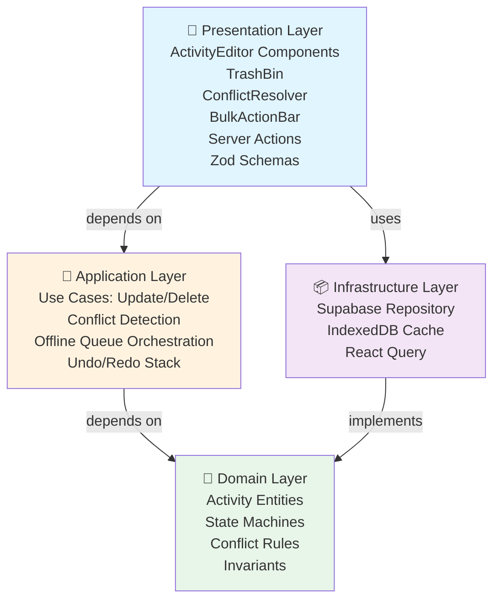
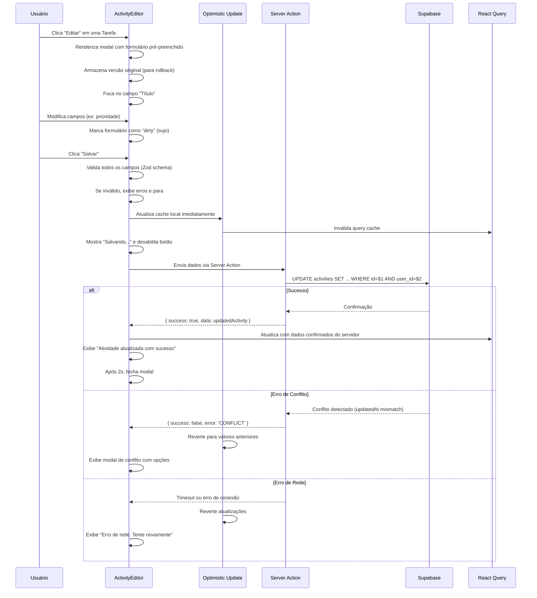
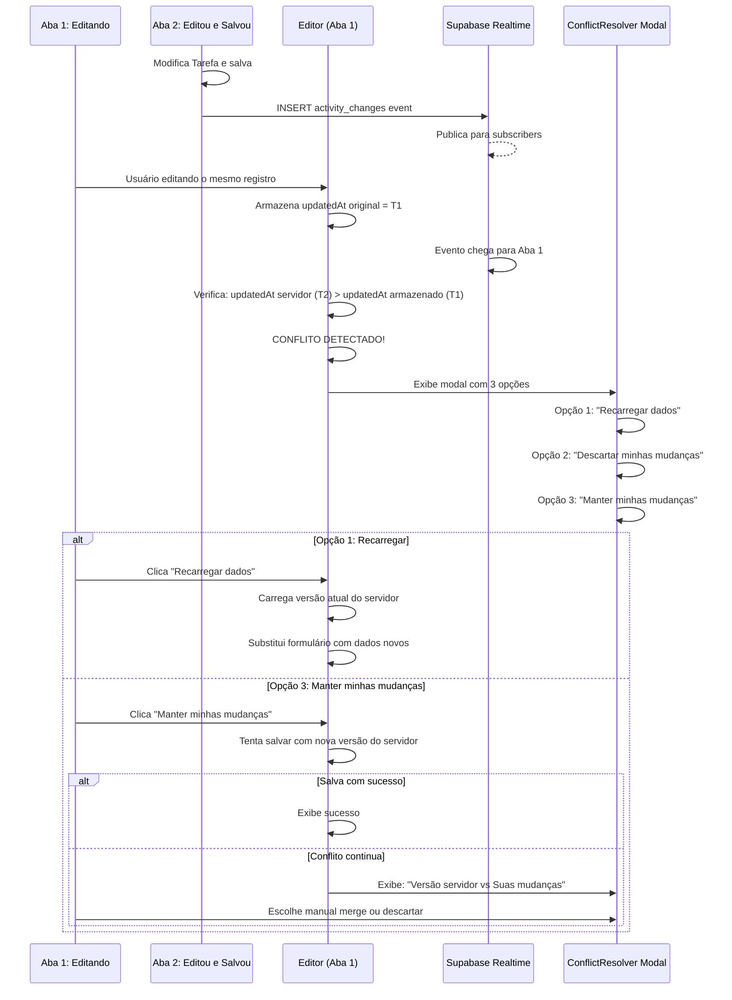
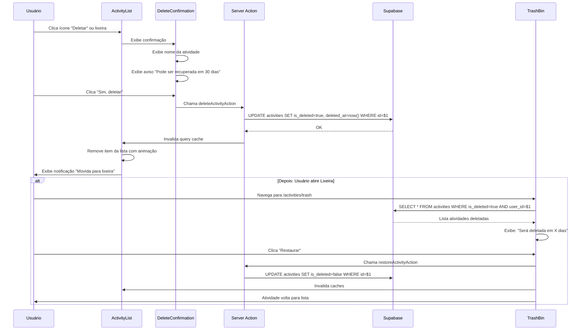
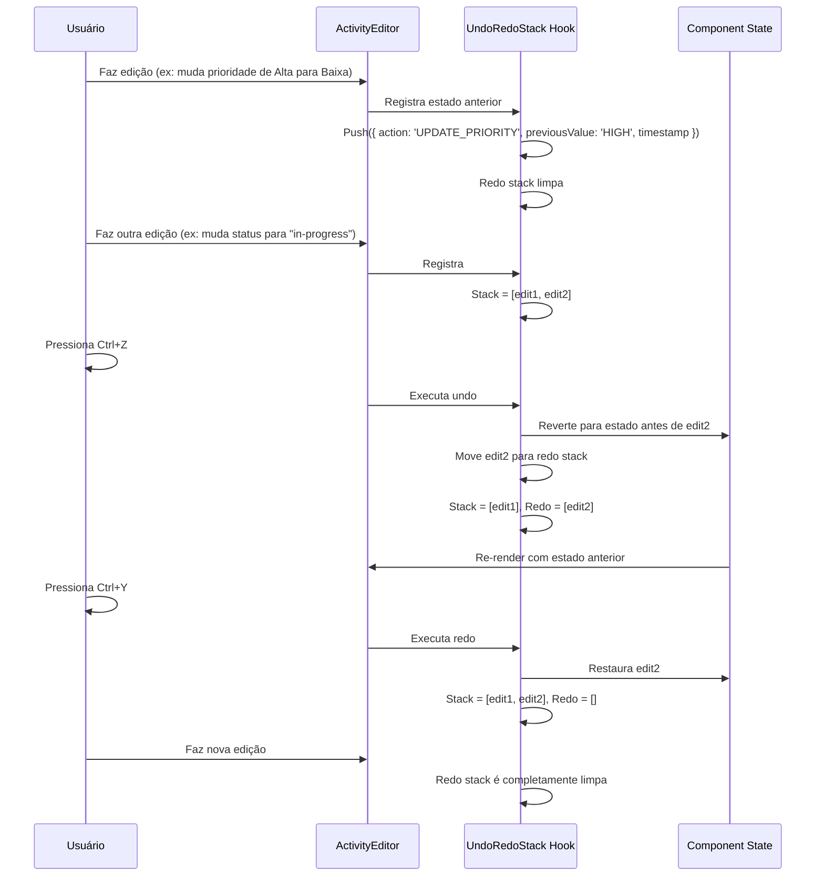
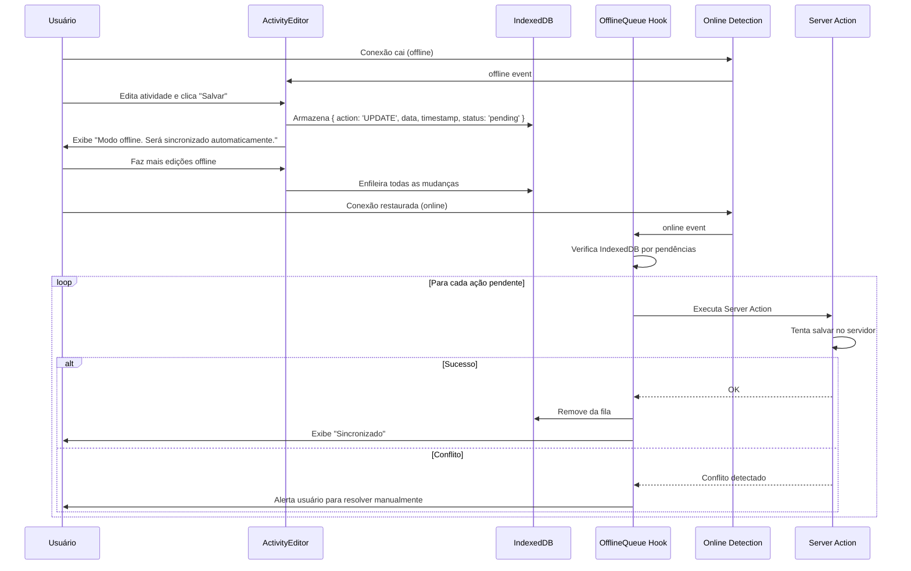

# Design Document: activity-crud

## Visão Geral

A feature **activity-crud** implementa a edição, atualização, deleção e resolução de conflitos para três tipos de atividades acadêmicas (Tarefas, Provas e Trabalhos). Esta feature desbloqueia o ciclo de vida completo das atividades: criar → listar → editar → deletar, fornecendo interface unificada com suporte a sincronização em tempo real, atualização otimista, undo/redo, operações em lote e tratamento robusto de conflitos concorrentes.

A arquitetura segue Clean Architecture com máquina de estados para validação de transições, IndexedDB para fila offline, React Query para cache inteligente, e Supabase real-time para sincronização entre dispositivos. Cada operação é idempotente e testável via propriedades, garantindo integridade de dados sob edição concorrente, falhas de rede e operações offline.

---

## Arquitetura em 4 Camadas



---

## Fluxos Principais

### Fluxo 1: Editar Atividade com Validação e Atualização Otimista



### Fluxo 2: Detectar e Resolver Conflito de Edição Concorrente



### Fluxo 3: Deletar com Soft Delete e Recuperação



### Fluxo 4: Undo/Redo Stack



### Fluxo 5: Sincronização Offline e Fila de Pendências



---

## Modelos de Dados (Domain Layer)

### Entity: Activity Base (abstrata)

```typescript
abstract class Activity {
  // Identificação
  id: string                                    // UUID, imutável
  userId: string                                // FK User, garantido por RLS
  type: 'TASK' | 'EXAM' | 'ASSIGNMENT'        // Discriminator
  
  // Conteúdo editável
  title: string                                 // 1-200 chars, obrigatório
  description?: string                          // max 2000 chars
  subjectId?: string                           // FK Subject, editável
  
  // Timeline
  createdAt: Date                               // UTC, imutável após criação
  updatedAt: Date                               // UTC, servidor gera
  
  // Soft delete
  isDeleted: boolean                            // Default: false
  deletedAt?: Date                              // Timestamp de deleção
  
  // Métodos
  abstract isEditable(): boolean
  abstract validateStatusTransition(newStatus: string): boolean
  matchesSearch(term: string): boolean
  canBeRestored(): boolean                      // true se < 30 dias na lixeira
}
```

**Invariantes:**
- `title` nunca vazio
- `userId` sempre presente (segurança)
- `createdAt` <= `now()`
- `updatedAt` >= `createdAt`
- Se `isDeleted=true`, então `deletedAt` deve estar presente
- Se `isDeleted=false`, então `deletedAt` deve ser null

---

### Entity: Task

```typescript
class Task extends Activity {
  // Status e prioridade
  dueDate?: Date                                // Data limite
  priority: 'LOW' | 'MEDIUM' | 'HIGH'         // Default: MEDIUM, editável
  status: 'TODO' | 'IN_PROGRESS' | 'COMPLETED' // Default: TODO, editável
  
  // Detalhes
  estimatedTimeMinutes?: number                // 0-999
  tags?: string[]                              // max 10
  
  // Métodos
  isEditable(): boolean {
    return !this.isDeleted && this.status !== 'COMPLETED'
    // Ou: sempre editável, mesmo completada
  }
  
  validateStatusTransition(newStatus: 'TODO' | 'IN_PROGRESS' | 'COMPLETED'): boolean {
    const validTransitions = {
      'TODO': ['IN_PROGRESS', 'COMPLETED'],
      'IN_PROGRESS': ['TODO', 'COMPLETED'],
      'COMPLETED': ['TODO']
    }
    return validTransitions[this.status]?.includes(newStatus) || false
  }
  
  isOverdue(): boolean {
    return this.dueDate && this.dueDate < new Date() && this.status !== 'COMPLETED'
  }
  
  getDaysUntilDue(): number | null {
    if (!this.dueDate) return null
    const diff = this.dueDate.getTime() - new Date().getTime()
    return Math.ceil(diff / (1000 * 60 * 60 * 24))
  }
  
  getUrgencyBadge(): 'overdue' | 'today' | 'soon' | 'upcoming' | 'none' {
    if (this.isOverdue()) return 'overdue'
    const daysUntil = this.getDaysUntilDue()
    if (daysUntil === 0) return 'today'
    if (daysUntil && daysUntil <= 3) return 'soon'
    if (daysUntil && daysUntil <= 7) return 'upcoming'
    return 'none'
  }
}
```

---

### Entity: Exam

```typescript
class Exam extends Activity {
  // Obrigatório
  date: Date                                   // Data do exame
  examType: 'WRITTEN' | 'ORAL' | 'PRACTICAL' // Tipo de prova
  
  // Opcional
  time?: string                                // HH:mm
  content?: string[]                           // Tópicos (array)
  location?: string                            // Local
  notes?: string                               // Anotações
  
  // Métodos
  isEditable(): boolean {
    return !this.isDeleted && !this.isPast()
  }
  
  isPast(): boolean {
    return this.date < new Date()
  }
  
  validateStatusTransition(newStatus: any): boolean {
    // Exames não têm transição de status
    return false
  }
}
```

---

### Entity: Assignment

```typescript
class Assignment extends Activity {
  // Obrigatório
  dueDate: Date                                // Data limite
  description: string                          // 1-3000 chars
  assignmentType: 'WRITTEN' | 'PRESENTATION' | 'PROJECT'
  
  // Status
  status: 'PENDING' | 'SUBMITTED' | 'GRADED' // Default: PENDING
  
  // Opcional
  criteria?: string                            // Critérios de avaliação
  submittedAt?: Date                           // Data de entrega
  gradedAt?: Date                              // Data de avaliação
  
  // Métodos
  isEditable(): boolean {
    return !this.isDeleted && this.status !== 'GRADED'
  }
  
  validateStatusTransition(newStatus: 'PENDING' | 'SUBMITTED' | 'GRADED'): boolean {
    const validTransitions = {
      'PENDING': ['SUBMITTED', 'GRADED'],
      'SUBMITTED': ['PENDING', 'GRADED'],
      'GRADED': ['PENDING']
    }
    return validTransitions[this.status]?.includes(newStatus) || false
  }
  
  isOverdue(): boolean {
    return this.dueDate < new Date() && this.status === 'PENDING'
  }
}
```

---

### Value Object: ConflictResolution

```typescript
type ConflictResolution = 
  | { type: 'RELOAD' }                         // Recarregar do servidor
  | { type: 'DISCARD' }                        // Descartar minhas mudanças
  | { type: 'MERGE', mergedData: Activity }    // Merge manual
  | { type: 'FORCE_SAVE', data: Activity }     // Salvar mesmo com conflito
```

---

### Value Object: UndoRedoAction

```typescript
interface UndoRedoAction {
  type: 'UPDATE' | 'DELETE' | 'RESTORE' | 'STATUS_CHANGE'
  activityId: string
  previousState: Activity | null                // null para DELETE (recovery data armazenado separado)
  newState?: Activity
  timestamp: Date
  description: string                           // "Prioridade alterada de Alta para Baixa"
}
```

---

### Value Object: OfflineQueueItem

```typescript
interface OfflineQueueItem {
  id: string                                    // UUID para rastreamento
  action: 'UPDATE' | 'DELETE'
  activityId: string
  data: Partial<Activity>
  createdAt: Date
  syncedAt?: Date
  status: 'PENDING' | 'SYNCED' | 'FAILED'
  error?: string
}
```

---

## Casos de Uso (Application Layer)

### Use Case 1: UpdateActivity

**Responsabilidade:** Validar dados, detectar conflitos, atualizar otimista, sincronizar com servidor.

```typescript
interface UpdateActivityInput {
  userId: string
  activityId: string
  data: Partial<Activity>
  expectedUpdatedAt: Date                      // Para detecção de conflito
}

interface UpdateActivityOutput {
  success: boolean
  data?: Activity
  conflict?: {
    serverData: Activity
    clientData: Partial<Activity>
  }
  error?: {
    code: 'CONFLICT' | 'VALIDATION_ERROR' | 'NOT_FOUND' | 'FORBIDDEN' | 'NETWORK_ERROR'
    message: string
  }
}
```

**Algoritmo:**

```
ALGORITHM UpdateActivity
INPUT: updateActivityInput
OUTPUT: updateActivityOutput

BEGIN
  // 1. Validate input
  VALIDATE data with schema (Zod)
  
  // 2. Fetch current activity from cache/DB
  current ← GET activity where id = activityId AND user_id = userId
  IF NOT current THEN
    RETURN { success: false, error: { code: 'NOT_FOUND' } }
  END IF
  
  // 3. Check permissions (implicit via RLS)
  IF current.user_id != userId THEN
    RETURN { success: false, error: { code: 'FORBIDDEN' } }
  END IF
  
  // 4. Validate state transitions
  IF data.status DEFINED AND current.status != data.status THEN
    IF NOT current.validateStatusTransition(data.status) THEN
      RETURN { success: false, error: { code: 'VALIDATION_ERROR', message: 'Transição inválida' } }
    END IF
  END IF
  
  // 5. Check for conflict (OptimisticUI)
  IF current.updatedAt > expectedUpdatedAt THEN
    RETURN {
      success: false,
      error: { code: 'CONFLICT' },
      conflict: { serverData: current, clientData: data }
    }
  END IF
  
  // 6. Merge fields (some are read-only)
  merged ← MERGE(current, data, EXCLUDED_FIELDS=['id', 'userId', 'createdAt', 'isDeleted', 'deletedAt'])
  
  // 7. Create server update
  updatePayload ← {
    ...data fields only,
    updatedAt: server_now()
  }
  
  // 8. Send to server
  result ← SERVER_ACTION updateActivityOnServer(activityId, updatePayload)
  
  IF result.error THEN
    RETURN {
      success: false,
      error: result.error
    }
  END IF
  
  // 9. Return updated activity
  RETURN {
    success: true,
    data: result.data
  }
END
```

---

### Use Case 2: DeleteActivity (Soft Delete)

```typescript
interface DeleteActivityInput {
  userId: string
  activityId: string
}

interface DeleteActivityOutput {
  success: boolean
  data?: {
    activityId: string
    deletedAt: Date
    recoveryDeadline: Date                    // deletedAt + 30 days
  }
  error?: {
    code: 'NOT_FOUND' | 'FORBIDDEN' | 'NETWORK_ERROR'
    message: string
  }
}
```

**Algoritmo:**

```
ALGORITHM DeleteActivity
INPUT: deleteActivityInput
OUTPUT: deleteActivityOutput

BEGIN
  // 1. Fetch activity
  activity ← GET activity where id = activityId AND user_id = userId
  IF NOT activity THEN
    RETURN { success: false, error: { code: 'NOT_FOUND' } }
  END IF
  
  // 2. Check permission
  IF activity.user_id != userId THEN
    RETURN { success: false, error: { code: 'FORBIDDEN' } }
  END IF
  
  // 3. Soft delete
  updatePayload ← {
    is_deleted: true,
    deleted_at: server_now()
  }
  
  result ← SERVER_ACTION deleteActivityOnServer(activityId, updatePayload)
  
  IF result.error THEN
    RETURN { success: false, error: result.error }
  END IF
  
  recoveryDeadline ← result.data.deletedAt + 30 days
  
  RETURN {
    success: true,
    data: {
      activityId,
      deletedAt: result.data.deletedAt,
      recoveryDeadline
    }
  }
END
```

---

### Use Case 3: RestoreActivity

```typescript
interface RestoreActivityInput {
  userId: string
  activityId: string
}

interface RestoreActivityOutput {
  success: boolean
  data?: Activity
  error?: { code: string; message: string }
}
```

---

### Use Case 4: BulkDeleteActivities

```typescript
interface BulkDeleteInput {
  userId: string
  activityIds: string[]
}

interface BulkDeleteOutput {
  success: boolean
  deleted: number
  failed: number
  results: Array<{
    activityId: string
    success: boolean
    error?: string
  }>
}
```

---

### Use Case 5: OfflineQueueSync

```typescript
interface OfflineQueueSyncInput {
  userId: string
  queue: OfflineQueueItem[]
}

interface OfflineQueueSyncOutput {
  synced: number
  failed: number
  conflicts: Array<{
    queueItem: OfflineQueueItem
    serverData: Activity
  }>
}
```

---

## Implementação Supabase (Infrastructure Layer)

### Schema SQL Extensions

**Tabela activities com soft delete:**

```sql
-- Adicionar colunas se não existirem
ALTER TABLE activities ADD COLUMN IF NOT EXISTS is_deleted BOOLEAN DEFAULT false;
ALTER TABLE activities ADD COLUMN IF NOT EXISTS deleted_at TIMESTAMP WITH TIME ZONE DEFAULT NULL;

-- Índices para lixeira
CREATE INDEX IF NOT EXISTS idx_activities_deleted 
  ON activities(user_id, is_deleted, deleted_at DESC);

-- Índice para atualização otimista (conflito detection)
CREATE INDEX IF NOT EXISTS idx_activities_updated_at 
  ON activities(user_id, updated_at DESC);

-- Soft delete policy: atividades deletadas não aparecem por padrão
CREATE POLICY "Hide deleted activities in list"
  ON activities FOR SELECT
  USING (user_id = auth.uid() AND NOT is_deleted);

CREATE POLICY "Show deleted activities only in trash view"
  ON activities FOR SELECT
  AS (SELECT query_context)
  USING (user_id = auth.uid() AND is_deleted AND view = 'trash');

-- Delete policy (apenas soft delete)
CREATE POLICY "Soft delete own activities"
  ON activities FOR UPDATE
  USING (user_id = auth.uid())
  WITH CHECK (user_id = auth.uid());

-- Restaurar
CREATE POLICY "Restore own deleted activities"
  ON activities FOR UPDATE
  USING (user_id = auth.uid() AND is_deleted)
  WITH CHECK (user_id = auth.uid() AND NOT is_deleted);
```

**Trigger para auto-delete após 30 dias:**

```sql
CREATE OR REPLACE FUNCTION delete_old_deleted_activities()
RETURNS void AS $$
BEGIN
  DELETE FROM activities
  WHERE is_deleted = true
    AND deleted_at < NOW() - INTERVAL '30 days';
END;
$$ LANGUAGE plpgsql;

-- Schedule via Supabase Edge Function (cron) ou application
```

---

## Componentes React (Presentation Layer)

### Componente: ActivityEditor (Polimórfico)

**Props:**

```typescript
interface ActivityEditorProps {
  activityId: string
  type: 'task' | 'exam' | 'assignment'
  isOpen: boolean
  onClose: () => void
  onSaved?: (activity: Activity) => void
}
```

**Estrutura:**

```typescript
export function ActivityEditor({ activityId, type, isOpen, onClose }: ActivityEditorProps) {
  // Estados
  const [formData, setFormData] = useState<Partial<Activity> | null>(null)
  const [originalData, setOriginalData] = useState<Activity | null>(null)
  const [isDirty, setIsDirty] = useState(false)
  const [isSaving, setIsSaving] = useState(false)
  const [errors, setErrors] = useState<Record<string, string>>({})
  const [conflict, setConflict] = useState<ConflictInfo | null>(null)
  const [expectedUpdatedAt, setExpectedUpdatedAt] = useState<Date | null>(null)

  // Hooks
  const { data: activity, isLoading } = useActivity(activityId, { enabled: isOpen })
  const { mutate: updateActivity } = useUpdateActivityMutation()
  const { canUndo, canRedo, undo, redo, recordAction } = useUndoRedo()
  
  // Load activity
  useEffect(() => {
    if (activity && isOpen) {
      setOriginalData(activity)
      setFormData(activity)
      setExpectedUpdatedAt(activity.updatedAt)
      inputRef.current?.focus()
    }
  }, [activity, isOpen])

  // Monitor for conflicts
  useEffect(() => {
    if (!isOpen || !expectedUpdatedAt) return
    
    const interval = setInterval(() => {
      // Check if activity was modified elsewhere
      queryClient.fetchQuery({ queryKey: ['activity', activityId] }).then(current => {
        if (current.updatedAt > expectedUpdatedAt) {
          setConflict({
            serverData: current,
            clientData: formData
          })
        }
      })
    }, 2000) // Check every 2 seconds

    return () => clearInterval(interval)
  }, [isOpen, expectedUpdatedAt, activityId])

  // Save handler
  async function handleSave() {
    // 1. Validate
    const validationErrors = validateActivityData(formData, type)
    if (Object.keys(validationErrors).length > 0) {
      setErrors(validationErrors)
      return
    }

    // 2. Optimistic update
    const previousData = { ...formData }
    setIsSaving(true)
    
    // Update local state immediately
    setFormData(prev => ({ ...prev, ...formData }))
    recordAction({
      type: 'UPDATE',
      previousState: originalData,
      newState: { ...formData } as Activity,
      description: 'Atividade editada'
    })

    // 3. Send to server
    try {
      const result = await updateActivity({
        activityId,
        data: formData,
        expectedUpdatedAt
      })

      if (result.success) {
        setOriginalData(result.data)
        setExpectedUpdatedAt(result.data.updatedAt)
        setIsDirty(false)
        toast.success('Atividade atualizada com sucesso')
        
        setTimeout(() => {
          onClose()
        }, 2000)
      } else if (result.error?.code === 'CONFLICT') {
        // Handle conflict
        setConflict({
          serverData: result.conflict.serverData,
          clientData: result.conflict.clientData
        })
        // Revert optimistic update
        setFormData(previousData)
      }
    } catch (error) {
      // Revert on error
      setFormData(previousData)
      toast.error('Erro ao salvar. Tente novamente.')
    } finally {
      setIsSaving(false)
    }
  }

  // Cancel handler
  function handleCancel() {
    if (isDirty) {
      if (confirm('Descartar alterações?')) {
        setFormData(originalData)
        setIsDirty(false)
        onClose()
      }
    } else {
      onClose()
    }
  }

  // Beforeunload
  useEffect(() => {
    function handleBeforeUnload(e: BeforeUnloadEvent) {
      if (isDirty) {
        e.preventDefault()
        e.returnValue = ''
      }
    }

    window.addEventListener('beforeunload', handleBeforeUnload)
    return () => window.removeEventListener('beforeunload', handleBeforeUnload)
  }, [isDirty])

  if (!isOpen) return null
  if (isLoading) return <EditorSkeleton />

  return (
    <Dialog open={isOpen} onOpenChange={onClose}>
      <DialogContent className="max-w-2xl">
        <DialogHeader>
          <DialogTitle>Editar {type === 'task' ? 'Tarefa' : type === 'exam' ? 'Exame' : 'Atribuição'}</DialogTitle>
          {originalData?.updatedAt && originalData.updatedAt > originalData.createdAt && (
            <p className="text-xs text-gray-500">
              Editada em {format(originalData.updatedAt, "d 'de' MMMM 'às' HH:mm", { locale: ptBR })}
            </p>
          )}
        </DialogHeader>

        {/* Conflict Modal */}
        {conflict && (
          <ConflictResolver
            serverData={conflict.serverData}
            clientData={conflict.clientData}
            onReload={() => {
              setFormData(conflict.serverData)
              setExpectedUpdatedAt(conflict.serverData.updatedAt)
              setConflict(null)
            }}
            onDiscard={() => {
              setFormData(conflict.serverData)
              setConflict(null)
            }}
            onKeep={() => {
              // Try to save again
              handleSave()
              setConflict(null)
            }}
          />
        )}

        {/* Form */}
        <form className="space-y-6" onKeyDown={(e) => {
          if ((e.ctrlKey || e.metaKey) && e.key === 'Enter') {
            handleSave()
          }
          if (e.key === 'Escape') {
            handleCancel()
          }
        }}>
          {/* Common fields */}
          <div className="space-y-4">
            <div>
              <label htmlFor="title" className="text-sm font-medium">
                Título *
              </label>
              <input
                ref={inputRef}
                id="title"
                type="text"
                maxLength={200}
                value={formData?.title || ''}
                onChange={(e) => {
                  setFormData(prev => ({ ...prev, title: e.target.value }))
                  setIsDirty(true)
                }}
                aria-required="true"
                aria-invalid={!!errors.title}
                aria-describedby={errors.title ? 'title-error' : undefined}
                className={`w-full px-3 py-2 border rounded-lg ${errors.title ? 'border-red-500' : 'border-gray-300'}`}
              />
              {errors.title && (
                <p id="title-error" className="text-xs text-red-500 mt-1">{errors.title}</p>
              )}
            </div>

            <div>
              <label htmlFor="description" className="text-sm font-medium">
                Descrição
              </label>
              <textarea
                id="description"
                maxLength={2000}
                value={formData?.description || ''}
                onChange={(e) => {
                  setFormData(prev => ({ ...prev, description: e.target.value }))
                  setIsDirty(true)
                }}
                className="w-full px-3 py-2 border rounded-lg"
                rows={4}
              />
            </div>

            {/* Task-specific fields */}
            {type === 'task' && (
              <>
                <div className="grid grid-cols-2 gap-4">
                  <div>
                    <label htmlFor="priority" className="text-sm font-medium">Prioridade</label>
                    <select
                      id="priority"
                      value={(formData as Task)?.priority || 'MEDIUM'}
                      onChange={(e) => {
                        setFormData(prev => ({ ...prev, priority: e.target.value }))
                        setIsDirty(true)
                      }}
                      className="w-full px-3 py-2 border rounded-lg"
                    >
                      <option value="LOW">Baixa</option>
                      <option value="MEDIUM">Média</option>
                      <option value="HIGH">Alta</option>
                    </select>
                  </div>

                  <div>
                    <label htmlFor="status" className="text-sm font-medium">Status</label>
                    <select
                      id="status"
                      value={(formData as Task)?.status || 'TODO'}
                      onChange={(e) => {
                        setFormData(prev => ({ ...prev, status: e.target.value }))
                        setIsDirty(true)
                      }}
                      className="w-full px-3 py-2 border rounded-lg"
                    >
                      <option value="TODO">A fazer</option>
                      <option value="IN_PROGRESS">Em progresso</option>
                      <option value="COMPLETED">Concluída</option>
                    </select>
                  </div>
                </div>

                <div>
                  <label htmlFor="dueDate" className="text-sm font-medium">Prazo</label>
                  <input
                    id="dueDate"
                    type="date"
                    value={(formData as Task)?.dueDate ? format((formData as Task).dueDate!, 'yyyy-MM-dd') : ''}
                    onChange={(e) => {
                      setFormData(prev => ({ ...prev, dueDate: new Date(e.target.value) }))
                      setIsDirty(true)
                    }}
                    className="w-full px-3 py-2 border rounded-lg"
                  />
                </div>
              </>
            )}

            {/* Exam-specific fields */}
            {type === 'exam' && (
              <>
                <div className="grid grid-cols-2 gap-4">
                  <div>
                    <label htmlFor="date" className="text-sm font-medium">Data *</label>
                    <input
                      id="date"
                      type="date"
                      value={(formData as Exam)?.date ? format((formData as Exam).date!, 'yyyy-MM-dd') : ''}
                      onChange={(e) => {
                        setFormData(prev => ({ ...prev, date: new Date(e.target.value) }))
                        setIsDirty(true)
                      }}
                      aria-required="true"
                      className="w-full px-3 py-2 border rounded-lg"
                    />
                  </div>
                  <div>
                    <label htmlFor="time" className="text-sm font-medium">Hora</label>
                    <input
                      id="time"
                      type="time"
                      value={(formData as Exam)?.time || ''}
                      onChange={(e) => {
                        setFormData(prev => ({ ...prev, time: e.target.value }))
                        setIsDirty(true)
                      }}
                      className="w-full px-3 py-2 border rounded-lg"
                    />
                  </div>
                </div>
                <div>
                  <label htmlFor="examType" className="text-sm font-medium">Tipo *</label>
                  <select
                    id="examType"
                    value={(formData as Exam)?.examType || 'WRITTEN'}
                    onChange={(e) => {
                      setFormData(prev => ({ ...prev, examType: e.target.value }))
                      setIsDirty(true)
                    }}
                    aria-required="true"
                    className="w-full px-3 py-2 border rounded-lg"
                  >
                    <option value="WRITTEN">Prova escrita</option>
                    <option value="ORAL">Prova oral</option>
                    <option value="PRACTICAL">Prova prática</option>
                  </select>
                </div>
              </>
            )}

            {/* Assignment-specific fields */}
            {type === 'assignment' && (
              <>
                <div>
                  <label htmlFor="assignmentType" className="text-sm font-medium">Tipo *</label>
                  <select
                    id="assignmentType"
                    value={(formData as Assignment)?.assignmentType || 'WRITTEN'}
                    onChange={(e) => {
                      setFormData(prev => ({ ...prev, assignmentType: e.target.value }))
                      setIsDirty(true)
                    }}
                    aria-required="true"
                    className="w-full px-3 py-2 border rounded-lg"
                  >
                    <option value="WRITTEN">Trabalho escrito</option>
                    <option value="PRESENTATION">Apresentação</option>
                    <option value="PROJECT">Projeto</option>
                  </select>
                </div>

                <div>
                  <label htmlFor="dueDate" className="text-sm font-medium">Prazo *</label>
                  <input
                    id="dueDate"
                    type="date"
                    value={(formData as Assignment)?.dueDate ? format((formData as Assignment).dueDate!, 'yyyy-MM-dd') : ''}
                    onChange={(e) => {
                      setFormData(prev => ({ ...prev, dueDate: new Date(e.target.value) }))
                      setIsDirty(true)
                    }}
                    aria-required="true"
                    className="w-full px-3 py-2 border rounded-lg"
                  />
                </div>

                <div>
                  <label htmlFor="status" className="text-sm font-medium">Status</label>
                  <select
                    id="status"
                    value={(formData as Assignment)?.status || 'PENDING'}
                    onChange={(e) => {
                      setFormData(prev => ({ ...prev, status: e.target.value }))
                      setIsDirty(true)
                    }}
                    className="w-full px-3 py-2 border rounded-lg"
                  >
                    <option value="PENDING">Pendente</option>
                    <option value="SUBMITTED">Entregue</option>
                    <option value="GRADED">Avaliada</option>
                  </select>
                </div>
              </>
            )}

            {/* Read-only fields */}
            <div className="grid grid-cols-2 gap-4 pt-4 border-t">
              <div>
                <label className="text-xs text-gray-500 font-medium">Criada em</label>
                <p className="text-sm text-gray-600 py-2 bg-gray-50 px-3 rounded-lg">
                  {originalData?.createdAt ? format(originalData.createdAt, "d 'de' MMMM 'de' yyyy", { locale: ptBR }) : '—'}
                </p>
              </div>
              <div>
                <label className="text-xs text-gray-500 font-medium">Última atualização</label>
                <p className="text-sm text-gray-600 py-2 bg-gray-50 px-3 rounded-lg">
                  {originalData?.updatedAt ? format(originalData.updatedAt, "d 'de' MMMM 'às' HH:mm", { locale: ptBR }) : '—'}
                </p>
              </div>
            </div>
          </div>

          {/* Buttons */}
          <DialogFooter className="flex justify-between pt-6">
            <div className="flex gap-2">
              <Button
                variant="outline"
                size="sm"
                onClick={undo}
                disabled={!canUndo || isSaving}
                title="Ctrl+Z"
              >
                ↶ Desfazer
              </Button>
              <Button
                variant="outline"
                size="sm"
                onClick={redo}
                disabled={!canRedo || isSaving}
                title="Ctrl+Y"
              >
                ↷ Refazer
              </Button>
            </div>

            <div className="flex gap-2">
              <Button
                variant="outline"
                onClick={handleCancel}
                disabled={isSaving}
              >
                Cancelar
              </Button>
              <Button
                onClick={handleSave}
                disabled={isSaving || !isDirty}
              >
                {isSaving ? (
                  <>
                    <Loader2 className="w-4 h-4 mr-2 animate-spin" />
                    Salvando...
                  </>
                ) : (
                  'Salvar'
                )}
              </Button>
            </div>
          </DialogFooter>
        </form>
      </DialogContent>
    </Dialog>
  )
}
```

---

### Componente: TrashBin

```typescript
interface TrashBinProps {
  isOpen: boolean
  onClose: () => void
}

export function TrashBin({ isOpen, onClose }: TrashBinProps) {
  const { data: deletedActivities, isLoading } = useDeletedActivities()
  const { mutate: restoreActivity } = useRestoreActivityMutation()
  const { mutate: permanentlyDeleteActivity } = usePermanentDeleteMutation()

  function getDaysUntilPermanentDelete(deletedAt: Date): number {
    const daysLeft = 30 - Math.floor((Date.now() - deletedAt.getTime()) / (1000 * 60 * 60 * 24))
    return Math.max(0, daysLeft)
  }

  return (
    <Dialog open={isOpen} onOpenChange={onClose}>
      <DialogContent>
        <DialogHeader>
          <DialogTitle>Lixeira</DialogTitle>
          <DialogDescription>
            Atividades aqui são removidas permanentemente após 30 dias
          </DialogDescription>
        </DialogHeader>

        {isLoading && <SkeletonLoader count={3} />}
        
        {!isLoading && deletedActivities?.length === 0 && (
          <p className="text-center text-gray-500 py-8">Nenhuma atividade na lixeira</p>
        )}

        {!isLoading && deletedActivities && (
          <div className="space-y-3">
            {deletedActivities.map(activity => (
              <div key={activity.id} className="p-4 border rounded-lg flex justify-between items-center">
                <div>
                  <h4 className="font-medium line-clamp-1">{activity.title}</h4>
                  <p className="text-xs text-gray-500">
                    Deletada em {format(activity.deletedAt!, 'd MMM, HH:mm', { locale: ptBR })}
                  </p>
                  <p className="text-xs text-orange-600 font-medium">
                    Será removida em {getDaysUntilPermanentDelete(activity.deletedAt!)} dias
                  </p>
                </div>

                <div className="flex gap-2">
                  <Button
                    variant="outline"
                    size="sm"
                    onClick={() => restoreActivity({ activityId: activity.id })}
                  >
                    Restaurar
                  </Button>
                  <Button
                    variant="destructive"
                    size="sm"
                    onClick={() => {
                      if (confirm('Deletar permanentemente?')) {
                        permanentlyDeleteActivity({ activityId: activity.id })
                      }
                    }}
                  >
                    Deletar
                  </Button>
                </div>
              </div>
            ))}
          </div>
        )}

        <DialogFooter>
          <Button onClick={onClose}>Fechar</Button>
        </DialogFooter>
      </DialogContent>
    </Dialog>
  )
}
```

---

### Componente: ConflictResolver

```typescript
interface ConflictResolverProps {
  serverData: Activity
  clientData: Partial<Activity>
  onReload: () => void
  onDiscard: () => void
  onKeep: () => void
}

export function ConflictResolver({
  serverData,
  clientData,
  onReload,
  onDiscard,
  onKeep
}: ConflictResolverProps) {
  return (
    <Dialog open>
      <DialogContent>
        <DialogHeader>
          <DialogTitle>⚠️ Conflito de Edição</DialogTitle>
          <DialogDescription>
            Esta atividade foi modificada em outro dispositivo. Escolha como resolver:
          </DialogDescription>
        </DialogHeader>

        <div className="space-y-4">
          {/* Opção 1 */}
          <div
            className="p-4 border rounded-lg cursor-pointer hover:bg-blue-50"
            onClick={onReload}
          >
            <h4 className="font-medium">🔄 Recarregar dados do servidor</h4>
            <p className="text-xs text-gray-500 mt-1">
              Suas alterações locais serão descartadas. Use esta opção se o servidor está mais atual.
            </p>
          </div>

          {/* Opção 2 */}
          <div
            className="p-4 border rounded-lg cursor-pointer hover:bg-red-50"
            onClick={onDiscard}
          >
            <h4 className="font-medium">✕ Descartar minhas mudanças</h4>
            <p className="text-xs text-gray-500 mt-1">
              Fechar o editor sem salvar. A versão do servidor permanece.
            </p>
          </div>

          {/* Opção 3 */}
          <div
            className="p-4 border rounded-lg cursor-pointer hover:bg-green-50"
            onClick={onKeep}
          >
            <h4 className="font-medium">✓ Manter minhas mudanças</h4>
            <p className="text-xs text-gray-500 mt-1">
              Tentar salvar suas alterações. Pode resultar em novo conflito.
            </p>
          </div>
        </div>

        {/* Comparison */}
        <div className="mt-6 pt-4 border-t">
          <p className="text-xs font-medium text-gray-600 mb-3">Detalhes da divergência:</p>
          <div className="grid grid-cols-2 gap-4 text-xs">
            <div className="bg-gray-50 p-3 rounded">
              <p className="font-medium text-gray-700">Servidor:</p>
              <pre className="text-gray-600 overflow-auto max-h-32 mt-1">
                {JSON.stringify(serverData, null, 2)}
              </pre>
            </div>
            <div className="bg-gray-50 p-3 rounded">
              <p className="font-medium text-gray-700">Suas mudanças:</p>
              <pre className="text-gray-600 overflow-auto max-h-32 mt-1">
                {JSON.stringify(clientData, null, 2)}
              </pre>
            </div>
          </div>
        </div>
      </DialogContent>
    </Dialog>
  )
}
```

---

### Componente: BulkActionBar

```typescript
interface BulkActionBarProps {
  selectedIds: string[]
  activities: Activity[]
  onBulkDelete: (ids: string[]) => void
  onBulkStatusChange: (ids: string[], status: string) => void
  onSelectionChange: (ids: string[]) => void
}

export function BulkActionBar({
  selectedIds,
  activities,
  onBulkDelete,
  onBulkStatusChange,
  onSelectionChange
}: BulkActionBarProps) {
  const [selectedStatus, setSelectedStatus] = useState<string>('')

  if (selectedIds.length === 0) return null

  return (
    <div className="sticky bottom-0 bg-white border-t shadow-lg p-4 flex justify-between items-center">
      <div>
        <p className="font-medium">{selectedIds.length} selecionadas</p>
      </div>

      <div className="flex gap-3">
        {/* Status Change */}
        <select
          value={selectedStatus}
          onChange={(e) => {
            if (e.target.value) {
              onBulkStatusChange(selectedIds, e.target.value)
              setSelectedStatus('')
            }
          }}
          className="px-3 py-2 border rounded"
        >
          <option value="">Novo status...</option>
          <option value="TODO">A fazer</option>
          <option value="IN_PROGRESS">Em progresso</option>
          <option value="COMPLETED">Concluída</option>
        </select>

        {/* Delete */}
        <Button
          variant="destructive"
          onClick={() => {
            if (confirm(`Deletar ${selectedIds.length} atividades?`)) {
              onBulkDelete(selectedIds)
              onSelectionChange([])
            }
          }}
        >
          🗑️ Deletar {selectedIds.length}
        </Button>

        {/* Clear */}
        <Button
          variant="outline"
          onClick={() => onSelectionChange([])}
        >
          Limpar
        </Button>
      </div>
    </div>
  )
}
```

---

### Hook: useUndoRedo

```typescript
interface UseUndoRedoOptions {
  maxStackSize?: number
}

export function useUndoRedo(options: UseUndoRedoOptions = {}) {
  const { maxStackSize = 10 } = options
  const [undoStack, setUndoStack] = useState<UndoRedoAction[]>([])
  const [redoStack, setRedoStack] = useState<UndoRedoAction[]>([])

  const canUndo = undoStack.length > 0
  const canRedo = redoStack.length > 0

  function recordAction(action: UndoRedoAction) {
    setUndoStack(prev => {
      const newStack = [action, ...prev]
      return newStack.slice(0, maxStackSize)
    })
    setRedoStack([])  // Clear redo on new action
  }

  function undo() {
    if (!canUndo) return

    const action = undoStack[0]
    setUndoStack(prev => prev.slice(1))
    setRedoStack(prev => [action, ...prev])

    // Aplicar undo (delegado ao componente)
    return action
  }

  function redo() {
    if (!canRedo) return

    const action = redoStack[0]
    setRedoStack(prev => prev.slice(1))
    setUndoStack(prev => [action, ...prev])

    // Aplicar redo (delegado ao componente)
    return action
  }

  return {
    canUndo,
    canRedo,
    undo,
    redo,
    recordAction
  }
}
```

---

### Hook: useOfflineQueue

```typescript
export function useOfflineQueue(userId: string) {
  const [queue, setQueue] = useState<OfflineQueueItem[]>([])
  const [isOnline, setIsOnline] = useState(navigator.onLine)

  // Carregar fila do IndexedDB
  useEffect(() => {
    loadQueueFromIndexedDB(userId).then(setQueue)
  }, [userId])

  // Monitorar online/offline
  useEffect(() => {
    function handleOnline() {
      setIsOnline(true)
      syncQueue()
    }

    function handleOffline() {
      setIsOnline(false)
    }

    window.addEventListener('online', handleOnline)
    window.addEventListener('offline', handleOffline)

    return () => {
      window.removeEventListener('online', handleOnline)
      window.removeEventListener('offline', handleOffline)
    }
  }, [])

  async function addToQueue(item: OfflineQueueItem) {
    const updated = [...queue, item]
    setQueue(updated)
    await saveQueueToIndexedDB(userId, updated)
  }

  async function syncQueue() {
    for (const item of queue.filter(i => i.status === 'PENDING')) {
      try {
        await syncItem(item)
        item.status = 'SYNCED'
        item.syncedAt = new Date()
      } catch (error) {
        item.status = 'FAILED'
        item.error = String(error)
      }
    }
    await saveQueueToIndexedDB(userId, queue)
  }

  return { queue, isOnline, addToQueue, syncQueue }
}
```

---

## Server Actions

### Server Action: updateActivityOnServer

**Arquivo:** `/src/features/activities/presentation/actions/updateActivity.ts`

```typescript
'use server'

import { z } from 'zod'
import { updateActivitySchema } from '../schemas/updateActivitySchema'
import { getCurrentUser } from '@/shared/lib/auth/helpers'
import { supabase } from '@/shared/lib/supabase/server'

export async function updateActivityAction(input: unknown) {
  try {
    // 1. Validate
    const validated = updateActivitySchema.parse(input)

    // 2. Get user
    const user = await getCurrentUser()
    if (!user) {
      return {
        success: false,
        error: { code: 'UNAUTHORIZED', message: 'Não autenticado' }
      }
    }

    // 3. Get current activity
    const { data: current, error: fetchError } = await supabase
      .from('activities')
      .select('*')
      .eq('id', validated.activityId)
      .eq('user_id', user.id)
      .single()

    if (fetchError || !current) {
      return {
        success: false,
        error: { code: 'NOT_FOUND', message: 'Atividade não encontrada' }
      }
    }

    // 4. Check conflict
    if (new Date(current.updated_at) > new Date(validated.expectedUpdatedAt)) {
      return {
        success: false,
        error: { code: 'CONFLICT', message: 'Conflito de edição' },
        conflict: {
          serverData: current,
          clientData: validated.data
        }
      }
    }

    // 5. Update
    const { data: updated, error: updateError } = await supabase
      .from('activities')
      .update({
        ...validated.data,
        updated_at: new Date().toISOString()
      })
      .eq('id', validated.activityId)
      .eq('user_id', user.id)
      .select()
      .single()

    if (updateError) {
      return {
        success: false,
        error: { code: 'UPDATE_ERROR', message: updateError.message }
      }
    }

    return {
      success: true,
      data: updated
    }
  } catch (error) {
    return {
      success: false,
      error: {
        code: 'VALIDATION_ERROR',
        message: error instanceof z.ZodError
          ? error.errors[0].message
          : 'Erro desconhecido'
      }
    }
  }
}
```

---

## Correctness Properties

*A property is a characteristic or behavior that should hold true across all valid executions of a system—essentially, a formal statement about what the system should do. Properties serve as the bridge between human-readable specifications and machine-verifiable correctness guarantees.*

### Property 1: Pre-population Round-Trip

**For any** edited activity, loading the activity into the editor and then capturing the form values should produce the same data as the original activity (except for timestamps).

**Validates: Requirements 1.2, 2.2, 3.2**

---

### Property 2: Validation Idempotence

**For any** invalid form data, running validation multiple times should produce identical error messages and the same invalid state.

**Validates: Requirements 4.1**

---

### Property 3: Save Disables on Invalid

**For any** form state where validation fails, the save button must be disabled and remain disabled until all errors are resolved.

**Validates: Requirements 4.4**

---

### Property 4: Optimistic Update Rollback

**For any** save operation that fails on the server, the UI state must be reverted to the previous valid state before the save was attempted.

**Validates: Requirements 7.3, 12.4**

---

### Property 5: Cancel Preserves Original

**For any** form with unsaved changes, clicking cancel should restore the form to its original values if the user confirms the discard prompt.

**Validates: Requirements 8.5**

---

### Property 6: Soft Delete Idempotency

**For any** activity, deleting it twice should result in the same final state (moved to trash, not further degraded).

**Validates: Requirements 9.3**

---

### Property 7: Restore Inverse of Delete

**For any** deleted activity that is restored, its visible state in the list should match the state before deletion (minus the deletedAt timestamp).

**Validates: Requirements 10.3**

---

### Property 8: Status Transition Validity

**For any** status change, only valid transitions defined by the state machine should be allowed, and invalid transitions should be rejected with an error.

**Validates: Requirements 13.1, 13.2, 13.3**

---

### Property 9: Conflict Detection

**For any** update where the server's updatedAt is later than the client's expectedUpdatedAt, a conflict should be detected and the user should be offered resolution options.

**Validates: Requirements 14.3, 14.4**

---

### Property 10: Realtime Sync Monotonic

**For any** list of activities being viewed, when a remote change arrives via Realtime, the list should update exactly once per change and never show duplicate or out-of-order updates.

**Validates: Requirements 16.2, 16.3, 16.4**

---

### Property 11: Undo State Recovery

**For any** undo operation, applying undo and then redo should result in the same state as before the undo was applied.

**Validates: Requirements 21.3, 22.2**

---

### Property 12: Undo Stack Bounded

**For any** sequence of edits, the undo stack should never exceed 10 items, with older items being dropped when the limit is reached.

**Validates: Requirements 21.5**

---

### Property 13: Redo Stack Cleared on New Action

**For any** redo stack, when a new action is recorded after an undo, the redo stack must be completely emptied.

**Validates: Requirements 21.4, 22.3**

---

### Property 14: Bulk Delete Atomicity

**For any** bulk delete operation, either all items are moved to trash or the operation fails atomically—no partial success with some items deleted and others not.

**Validates: Requirements 19.4, 20.3**

---

### Property 15: Quick Action Idempotency

**For any** rapid clicks on a quick action button (like "mark complete"), the system should debounce and execute only once, resulting in a single state change.

**Validates: Requirements 12.5**

---

### Property 16: Editor Modal Escape Key

**For any** open editor modal, pressing the Escape key must close it; if there are unsaved changes, a confirmation dialog should appear.

**Validates: Requirements 25.4**

---

### Property 17: Keyboard Ctrl+Z Undo

**For any** keystroke Ctrl+Z (or Cmd+Z on Mac) while the editor is focused, the most recent edit should be undone and the form reverted.

**Validates: Requirements 25.3, 21.2**

---

### Property 18: Accessibility Labels Present

**For any** input field in the editor form, there must be an associated `<label>` element with `htmlFor` pointing to the input's id, and required fields must have `aria-required="true"`.

**Validates: Requirements 26.1, 26.2**

---

### Property 19: Save Button State Machine

**For any** save operation, the button must transition: "Salvar" → "Salvando..." (disabled) → "Salvo" (2s) → "Salvar", or on error: "Salvando..." (disabled) → "Erro. Tente novamente".

**Validates: Requirements 27.1, 27.2, 27.3, 27.4, 27.5**

---

### Property 20: Unsaved Changes Warn on Exit

**For any** editor with dirty state (unsaved changes), attempting to navigate away or close the page must trigger a beforeunload confirmation dialog, and data must not be lost if the user cancels.

**Validates: Requirements 28.1, 28.2, 28.3, 28.4, 28.5**

---

### Property 21: Serialization Round-Trip

**For any** activity field value, serializing and then parsing should produce an equivalent value (equality of content, not reference).

**Validates: Requirements 29.1, 29.2, 29.4**

---

### Property 22: Update Idempotence

**For any** activity, calling the update action twice with identical data (same fields, same values) should result in the same final state and data, even though timestamps may differ.

**Validates: Requirements 30.1, 30.2, 30.4**

---

### Property 23: Read-Only Field Ignored

**For any** update request that includes read-only fields (id, createdAt, userId), those fields must be ignored and not updated in the database.

**Validates: Requirements 30.3**

---

### Property 24: Offline Queue Sync Idempotent

**For any** offline queue item, syncing it multiple times should result in the same final state on the server as syncing it once.

**Validates: Requirements 18.1, 18.3, 18.5**

---

### Property 25: Conflict Resolution Option Idempotency

**For any** conflict resolution choice (reload, discard, keep), applying the same choice repeatedly should result in the same state as applying it once.

**Validates: Requirements 15.1, 15.2, 15.3**

---

### Property 26: Responsive Modal Width

**For any** viewport width ≤ 768px, the editor modal must be full-screen; for width > 768px, it must be centered with 600px width, and form fields must be appropriately sized for each breakpoint.

**Validates: Requirements 24.1, 24.3, 24.4, 24.5**

---

### Property 27: Timestamp Monotonicity

**For any** activity that is updated, its updatedAt timestamp must be greater than or equal to its previous updatedAt value, and always ≥ createdAt.

**Validates: Requirements 3.5, 11.2, 13.4**

---

### Property 28: Status Transition Completeness

**For any** activity type, the set of allowed transitions must form a valid directed graph where every state is reachable and no transition violates business rules (e.g., cannot transition from GRADED directly to SUBMITTED).

**Validates: Requirements 13.1, 13.2**

---

### Property 29: Editor Field Population Consistency

**For any** edited activity, each field in the editor form must display the exact current value from the database, with no omissions or transformations (except for UI formatting like date picker format).

**Validates: Requirements 1.2, 2.2, 3.2**

---

### Property 30: Conflict Modal Options Completeness

**For any** conflict scenario, the user must be presented with at least three distinct, functional resolution options: reload from server, discard local changes, or attempt to keep local changes.

**Validates: Requirements 14.5**

---

## Estratégia de Testes

### Testes Unitários (Vitest)

**Domain Layer:**
- Test entity invariants (title cannot be empty, dates are valid, etc.)
- Test state machine transitions (valid vs invalid transitions)
- Test conflict detection logic
- Target: 90%+ coverage

```typescript
describe('Task State Transitions', () => {
  it('should allow todo → in-progress', () => {
    const task = new Task({ status: 'TODO' })
    expect(task.validateStatusTransition('IN_PROGRESS')).toBe(true)
  })

  it('should reject todo → graded', () => {
    const task = new Task({ status: 'TODO' })
    expect(task.validateStatusTransition('GRADED')).toBe(false)
  })
})
```

**Application Layer:**
- Test use case orchestration
- Test conflict detection logic
- Test offline queue management
- Mock repositories and external services
- Target: 80%+ coverage

```typescript
describe('UpdateActivity Use Case', () => {
  it('should detect conflict if server is newer', async () => {
    const result = await updateActivityUseCase({
      userId: 'user-1',
      activityId: 'activity-1',
      data: { title: 'New Title' },
      expectedUpdatedAt: new Date('2024-01-01')
    })
    expect(result.error?.code).toBe('CONFLICT')
  })
})
```

### Testes de Propriedade (fast-check)

**Cada propriedade deve ter um teste:**

```typescript
describe('Activity CRUD - Correctness Properties', () => {
  // Property 1: Pre-population Round-Trip
  it('Property 1: Pre-population Round-Trip - for all activities, form values should match original',
    fc.assert(
      fc.property(activityArbitrary, (activity) => {
        const formData = populateEditorForm(activity)
        const roundTrip = extractActivityFromForm(formData)
        return activitiesEqual(roundTrip, activity)
      }),
      { numRuns: 100 }
    )
  )

  // Property 4: Optimistic Update Rollback
  it('Property 4: Optimistic Update Rollback - failed saves must revert to previous state',
    fc.assert(
      fc.property(
        activityArbitrary,
        fc.record({ title: fc.string() }),
        (activity, changes) => {
          const previous = { ...activity }
          applyOptimisticUpdate(changes)
          simulateServerError()
          rollbackOptimisticUpdate()
          return stateEquals(current, previous)
        }
      ),
      { numRuns: 100 }
    )
  )

  // Property 11: Undo State Recovery
  it('Property 11: Undo State Recovery - undo then redo should restore original state',
    fc.assert(
      fc.property(
        editActionArbitrary,
        (action) => {
          recordUndoAction(action)
          const afterUndo = getEditorState()
          redo()
          const afterRedo = getEditorState()
          return statesEqual(afterRedo, beforeAction)
        }
      ),
      { numRuns: 100 }
    )
  )

  // Property 22: Update Idempotence
  it('Property 22: Update Idempotence - calling update twice with same data should be idempotent',
    fc.assert(
      fc.property(
        activityArbitrary,
        fc.record({ title: fc.string(), priority: fc.oneof(fc.constant('LOW'), fc.constant('HIGH')) }),
        async (activity, changes) => {
          const state1 = await updateActivity(activity.id, changes)
          const state2 = await updateActivity(activity.id, changes)
          return statesEqual(state1, state2)
        }
      ),
      { numRuns: 100 }
    )
  )
})
```

### Testes de Integração

- Test editor form submission end-to-end
- Test conflict resolution workflow
- Test offline queue sync on network recovery
- Mock Supabase, test full flow
- Target: 75%+ coverage

### Testes E2E (Playwright)

- User flow: open activity → edit fields → save → see update
- Conflict scenario: two tabs, one saves while other editing
- Undo/Redo: make changes → undo → verify UI
- Offline: disable network → make changes → enable → verify sync
- Trash: delete → see in trash → restore → verify in list

---

## Conclusão

Este design document especifica a implementação completa da feature activity-crud seguindo Clean Architecture, com propriedades formais testáveis, componentes polimórficos reutilizáveis, e tratamento robusto de cenários concorrentes e offline. Cada requisito é rastreável para pelo menos uma propriedade ou teste, garantindo que a implementação atenda especificações e seja verificável automaticamente.

