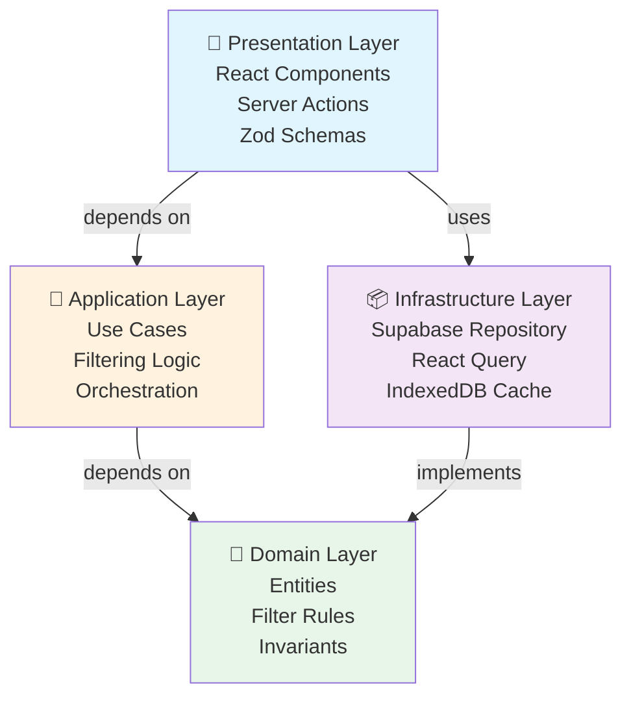
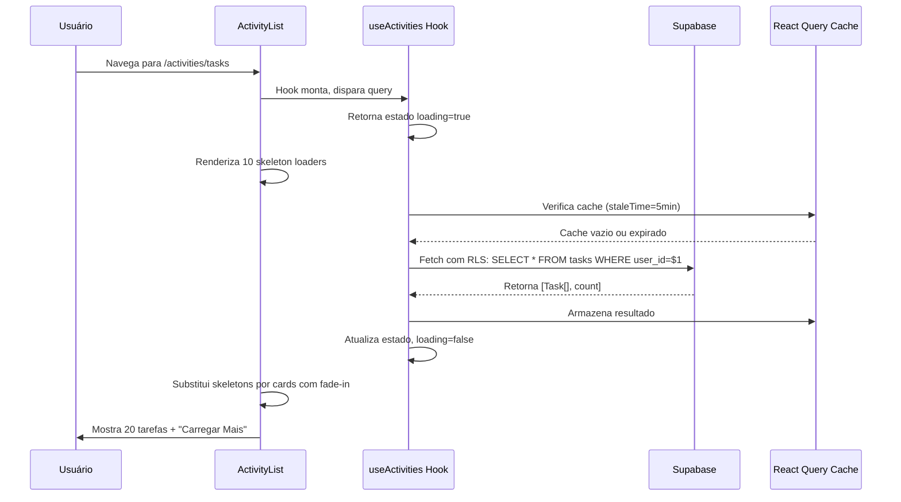
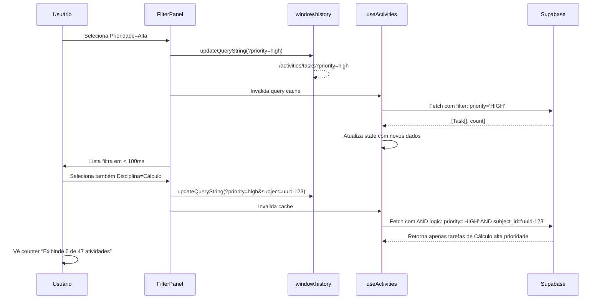
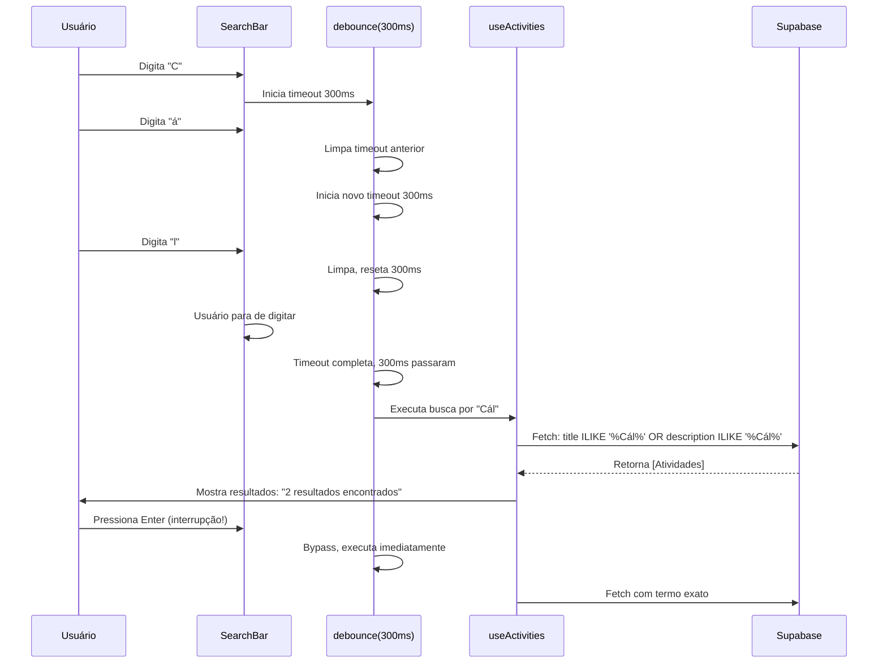
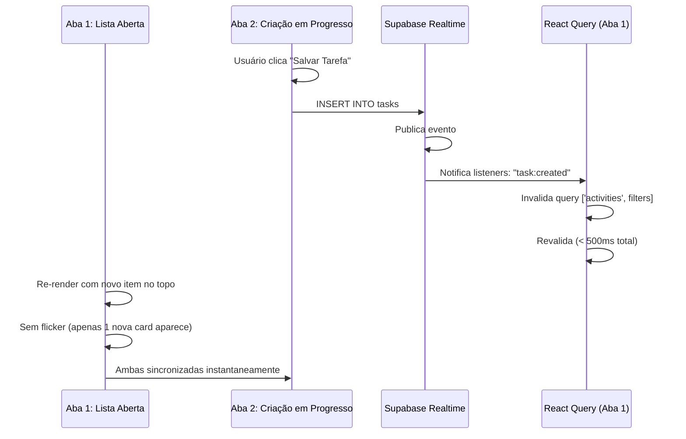
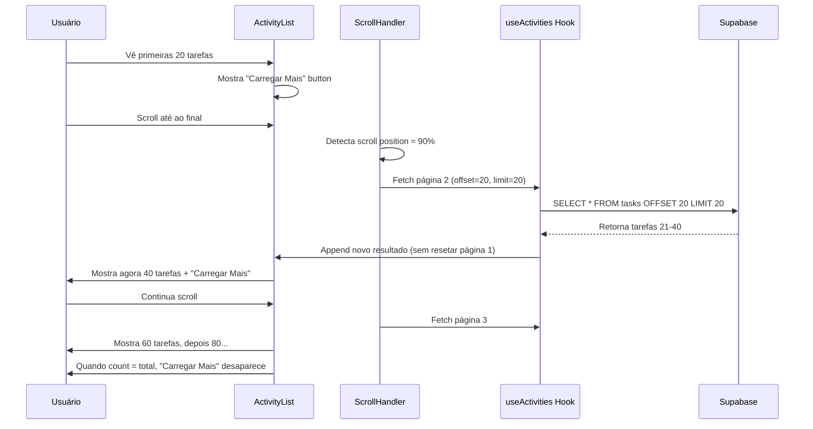

# Design Document: activity-list-filter

## Visão Geral

A feature **activity-list-filter** implementa a listagem, filtragem, busca e sincronização em tempo real de três tipos de atividades (Tarefas, Provas e Trabalhos). Esta feature desbloqueia o valor central do MVP: permitir que estudantes consultem, organizem e localizem rapidamente suas atividades acadêmicas com filtros essenciais, busca intuitiva e carregamento responsivo (< 500ms para disciplinas, < 100ms para aplicação de filtros).

A arquitetura segue Clean Architecture com sincronização Realtime via Supabase, cache inteligente com React Query + IndexedDB, e interface totalmente responsiva (mobile-first). Suporta múltiplos filtros com lógica AND/OR, debounce de busca, paginação/infinite scroll, e sincronização em tempo real entre abas/dispositivos sem flickering.

---

## Arquitetura em 4 Camadas



**Fluxo de Dados:**
1. **Presentation:** Usuário interage com filtros/busca → Server Action
2. **Application:** Orquestra validação → combinação de filtros
3. **Domain:** Valida regras de negócio (ex: dateFrom <= dateTo)
4. **Infrastructure:** Query otimizada com índices + cache React Query

---

## Fluxos Principais

### Fluxo 1: Carregamento Inicial com Skeleton Loaders



### Fluxo 2: Aplicação de Múltiplos Filtros com URL Sync



### Fluxo 3: Busca com Debounce



### Fluxo 4: Sincronização Realtime entre Abas



### Fluxo 5: Infinite Scroll com Paginação



---

## Modelos de Dados (Domain Layer)

### Entity: Activity Base (abstrata)

```typescript
abstract class Activity {
  // Identificação
  id: string                                    // UUID
  userId: string                                // FK User, garantido por RLS
  type: 'TASK' | 'EXAM' | 'ASSIGNMENT'        // Discriminator
  
  // Conteúdo
  title: string                                 // 1-200 chars
  description?: string                          // max 2000 chars
  subjectId?: string                           // FK Subject
  
  // Timeline
  createdAt: Date                               // UTC
  updatedAt: Date                               // UTC
  
  // Métodos
  isVisible(): boolean                          // Sempre true para lista
  matchesSearch(term: string): boolean
  matchesFilters(filters: FilterCriteria): boolean
}
```

**Invariantes:**
- `title` nunca vazio
- `userId` sempre presente (segurança)
- `createdAt` <= `now()`
- `updatedAt` >= `createdAt`

---

### Entity: Task (especializa Activity)

```typescript
class Task extends Activity {
  dueDate?: Date                                // Data limite
  priority: 'LOW' | 'MEDIUM' | 'HIGH'         // Default: MEDIUM
  status: 'TODO' | 'IN_PROGRESS' | 'COMPLETED' // Default: TODO
  
  estimatedTimeMinutes?: number                // 0-999
  tags?: string[]                              // max 10
  
  isOverdue(): boolean {
    return this.dueDate && this.dueDate < new Date() && this.status !== 'COMPLETED'
  }
  
  getDaysUntilDue(): number | null {
    if (!this.dueDate) return null
    const diff = this.dueDate.getTime() - new Date().getTime()
    return Math.ceil(diff / (1000 * 60 * 60 * 24))
  }
  
  getUrgencyBadge(): 'overdue' | 'today' | 'soon' | 'upcoming' | 'none' {
    if (this.isOverdue()) return 'overdue'
    const daysUntil = this.getDaysUntilDue()
    if (daysUntil === 0) return 'today'
    if (daysUntil && daysUntil <= 3) return 'soon'
    if (daysUntil && daysUntil <= 7) return 'upcoming'
    return 'none'
  }
}
```

---

### Entity: Exam (especializa Activity)

```typescript
class Exam extends Activity {
  date: Date                                   // Obrigatório
  time?: string                                // HH:mm
  examType: 'WRITTEN' | 'ORAL' | 'PRACTICAL' // Obrigatório
  content?: string[]                           // Topics
  location?: string                            // Room/location
  notes?: string                               // Notes
  
  isPast(): boolean {
    return this.date < new Date()
  }
  
  getFormattedDate(): string {
    // "Terça, 15 de janeiro às 14:00"
  }
}
```

---

### Entity: Assignment (especializa Activity)

```typescript
class Assignment extends Activity {
  dueDate: Date                                // Obrigatório
  assignmentType: 'WRITTEN' | 'PRESENTATION' | 'PROJECT'
  description: string                          // Obrigatório, 1-3000 chars
  criteria?: string                            // Grading criteria
  status: 'PENDING' | 'SUBMITTED' | 'GRADED' // Default: PENDING
  
  submittedAt?: Date
  gradedAt?: Date
  
  isOverdue(): boolean {
    return this.dueDate < new Date() && this.status === 'PENDING'
  }
}
```

---

### Entity: FilterCriteria

```typescript
interface FilterCriteria {
  // Search
  search?: string                              // case-insensitive
  
  // For Tasks
  priority?: ('LOW' | 'MEDIUM' | 'HIGH')[]   // OR logic
  status?: ('TODO' | 'IN_PROGRESS' | 'COMPLETED')[]
  
  // For Assignments
  assignmentStatus?: ('PENDING' | 'SUBMITTED' | 'GRADED')[]
  
  // Universal
  subjectIds?: string[]                        // OR logic
  dateRange?: {
    from: Date
    to: Date
  }
  
  // Sorting
  sort?: 'date_asc' | 'date_desc' | 'priority_asc' | 'priority_desc' 
    | 'status_asc' | 'title_asc' | 'title_desc' | 'created_asc' | 'created_desc'
  
  // Pagination
  page?: number                                // 1-indexed
  limit?: number                               // 5-100, default 20
}
```

**Invariantes:**
- Se `dateRange` definido: `from` <= `to`
- Se `priority` definido: contém apenas valores válidos
- `page` >= 1
- `limit` em [5, 100]

---

## Casos de Uso (Application Layer)

### Use Case 1: GetActivities com Filtros

**Responsabilidade:** Orquestrar validação de filtros, query otimizada ao Supabase, cache e Realtime.

```typescript
interface GetActivitiesInput {
  userId: string
  filters: FilterCriteria
  activityType?: 'task' | 'exam' | 'assignment'  // Optional: specific type
}

interface GetActivitiesOutput {
  success: boolean
  data?: {
    activities: Activity[]
    total: number                               // Total sem paginação
    page: number
    limit: number
    hasMore: boolean                            // Indica se há próxima página
  }
  error?: {
    code: string
    message: string
  }
}
```

**Algoritmo:**

```
ALGORITHM GetActivities
INPUT: getActivitiesInput
OUTPUT: getActivitiesOutput

BEGIN
  // 1. Validate filters
  VALIDATE filters.dateRange: if defined, from <= to
  VALIDATE filters.limit: 5 <= limit <= 100
  VALIDATE filters.page: page >= 1
  
  // 2. Build query dynamically based on filters
  query ← SELECT * FROM activities WHERE user_id = userId
  
  IF search defined THEN
    query ← query AND (title ILIKE '%search%' OR description ILIKE '%search%')
  END IF
  
  IF filters.subjectIds THEN
    query ← query AND (subject_id IN subjectIds)    // OR logic
  END IF
  
  IF filters.dateRange THEN
    query ← query AND (due_date >= dateRange.from AND due_date <= dateRange.to)
  END IF
  
  IF filters.priority THEN
    query ← query AND (priority IN filters.priority)  // OR logic for Task
  END IF
  
  IF filters.status THEN
    query ← query AND (status IN filters.status)      // OR logic
  END IF
  
  // 3. Apply sorting
  SWITCH filters.sort
    CASE 'date_asc': ORDER BY due_date ASC
    CASE 'date_desc': ORDER BY due_date DESC
    CASE 'priority_asc': ORDER BY priority ASC
    CASE 'created_desc': ORDER BY created_at DESC
    DEFAULT: ORDER BY due_date ASC
  END SWITCH
  
  // 4. Get total count before pagination
  total ← COUNT from query
  
  // 5. Apply pagination
  offset ← (page - 1) * limit
  query ← query LIMIT limit OFFSET offset
  
  // 6. Execute query (with RLS applied automatically)
  activities ← EXECUTE query
  
  // 7. Return with pagination metadata
  hasMore ← (offset + limit) < total
  RETURN {
    success: true,
    data: {
      activities,
      total,
      page,
      limit,
      hasMore
    }
  }
END
```

---

## Implementação Supabase (Infrastructure Layer)

### Schema SQL (Reutilizado de activity-creation)

As tabelas principais já existem:
- `activities` (base table)
- `tasks` (especialização)
- `exams` (especialização)
- `assignments` (especialização)

**Índices Críticos Adicionados:**

```sql
-- Para listagem rápida (Req 13)
CREATE INDEX idx_activities_user_created_desc 
  ON activities(user_id, created_at DESC);

-- Para filtro por data (Req 13)
CREATE INDEX idx_activities_user_due_date 
  ON activities(user_id, COALESCE(due_date, created_at) ASC);

-- Para filtro por disciplina (Req 13)
CREATE INDEX idx_activities_user_subject 
  ON activities(user_id, subject_id);

-- Para filtro por prioridade (tasks)
CREATE INDEX idx_tasks_user_priority 
  ON tasks(user_id, priority);

-- Para full-text search (Req 4)
CREATE INDEX idx_activities_search 
  ON activities USING GIN(
    to_tsvector('portuguese', title || ' ' || COALESCE(description, ''))
  );
```

### RLS Policies (Já configuradas em activity-creation)

Verificar que todas as queries respeitam:
```sql
-- Exemplo de SELECT com RLS
SELECT a.* FROM activities a
  WHERE a.user_id = auth.uid()
  AND ...filtros adicionais;
```

---

## Componentes React (Presentation Layer)

### Componente: ActivityListPage

**Props:**
```typescript
interface ActivityListPageProps {
  type: 'task' | 'exam' | 'assignment'
}
```

**Comportamento:**
- Renderiza skeleton loaders no inicial
- Aplica filtros/busca com URL sync
- Suporta múltiplos filtros combinados
- Sincronização Realtime
- Responsive (mobile/tablet/desktop)

```typescript
export function ActivityListPage({ type }: ActivityListPageProps) {
  const router = useRouter()
  const searchParams = useSearchParams()
  
  // Parse filtros da URL
  const [filters, setFilters] = useState<FilterCriteria>(() => ({
    search: searchParams.get('search') || undefined,
    priority: searchParams.get('priority')?.split(','),
    subjectIds: searchParams.get('subject')?.split(','),
    dateRange: {
      from: new Date(searchParams.get('dateFrom') || Date.now() - 30*24*60*60*1000),
      to: new Date(searchParams.get('dateTo') || Date.now() + 90*24*60*60*1000)
    },
    sort: searchParams.get('sort') || 'date_asc',
    page: parseInt(searchParams.get('page') || '1'),
    limit: 20
  }))

  // Realtime subscription
  useActivityRealtime(type)

  // Fetch atividades
  const { data, isLoading, error } = useActivities({
    filters,
    type
  })

  // Sync URL quando filtros mudam
  useEffect(() => {
    const params = new URLSearchParams()
    if (filters.search) params.set('search', filters.search)
    if (filters.priority) params.set('priority', filters.priority.join(','))
    if (filters.subjectIds) params.set('subject', filters.subjectIds.join(','))
    params.set('dateFrom', filters.dateRange?.from.toISOString() || '')
    params.set('dateTo', filters.dateRange?.to.toISOString() || '')
    params.set('sort', filters.sort || 'date_asc')
    params.set('page', filters.page?.toString() || '1')
    
    router.push(`?${params.toString()}`, { shallow: true })
  }, [filters, router])

  return (
    <MainLayout>
      <div className="flex gap-6">
        {/* Sidebar: Filtros */}
        <aside className="hidden md:block w-64">
          <ActivityFilters
            filters={filters}
            onChange={setFilters}
            type={type}
          />
        </aside>

        {/* Main: Lista */}
        <main className="flex-1 md:flex-1">
          {/* Mobile: Expandible Filter Toggle */}
          <div className="md:hidden mb-4">
            <FilterToggle filters={filters} onChange={setFilters} />
          </div>

          {/* Busca + Ordenação */}
          <div className="flex gap-2 mb-4">
            <SearchBar
              value={filters.search}
              onChange={(search) => setFilters({ ...filters, search, page: 1 })}
              placeholder="Buscar atividades..."
            />
            <SortSelector
              value={filters.sort}
              onChange={(sort) => setFilters({ ...filters, sort })}
            />
          </div>

          {/* Counter */}
          {data && (
            <p className="text-sm text-gray-600 mb-2">
              Exibindo {data.activities.length} de {data.total} atividades
            </p>
          )}

          {/* Lista */}
          {isLoading && <SkeletonLoader count={5} />}
          {error && <ErrorState onRetry={() => refetch()} />}
          {!isLoading && data?.activities.length === 0 && (
            <EmptyState type={type} filters={filters} />
          )}
          {!isLoading && data && (
            <>
              <ActivityList
                activities={data.activities}
                isLoading={isLoading}
              />
              
              {/* Paginação */}
              {data.hasMore && (
                <div className="mt-6 text-center">
                  <Button
                    onClick={() => setFilters({ ...filters, page: (filters.page || 1) + 1 })}
                    variant="outline"
                  >
                    Carregar Mais ({data.page * data.limit} de {data.total})
                  </Button>
                </div>
              )}
            </>
          )}
        </main>
      </div>
    </MainLayout>
  )
}
```

---

### Componente: ActivityList

```typescript
interface ActivityListProps {
  activities: Activity[]
  isLoading?: boolean
}

export function ActivityList({ activities, isLoading }: ActivityListProps) {
  return (
    <div className="space-y-3">
      {activities.map((activity) => (
        <ActivityCard
          key={activity.id}
          activity={activity}
          variant={activity.type === 'TASK' ? 'task' : activity.type === 'EXAM' ? 'exam' : 'assignment'}
        />
      ))}
    </div>
  )
}
```

---

### Componente: ActivityCard (Polimórfico)

```typescript
interface ActivityCardProps {
  activity: Activity
  variant: 'task' | 'exam' | 'assignment'
}

export function ActivityCard({ activity, variant }: ActivityCardProps) {
  return (
    <div className="p-4 border rounded-lg hover:shadow-md transition">
      <div className="flex justify-between">
        <div className="flex-1">
          {/* Título + Disciplina */}
          <h3 className="font-semibold line-clamp-1 text-lg">{activity.title}</h3>
          {activity.subjectId && (
            <p className="text-xs text-gray-500">{getSubjectName(activity.subjectId)}</p>
          )}

          {/* Content variant-specific */}
          {variant === 'task' && (
            <div className="mt-2 flex items-center gap-4 text-sm">
              <span className="text-gray-600">
                {(activity as Task).getDaysUntilDue() !== null
                  ? `Prazo: ${getRelativeDate((activity as Task).dueDate)}`
                  : 'Sem prazo'}
              </span>
              <PriorityBadge priority={(activity as Task).priority} />
              <StatusIndicator status={(activity as Task).status} />
            </div>
          )}

          {variant === 'exam' && (
            <div className="mt-2 flex items-center gap-4 text-sm">
              <span>{(activity as Exam).getFormattedDate()}</span>
              <span className="bg-purple-100 text-purple-800 px-2 py-1 rounded text-xs">
                {(activity as Exam).examType}
              </span>
              {(activity as Exam).location && (
                <span className="flex items-center gap-1">
                  <MapPin className="w-4 h-4" /> {(activity as Exam).location}
                </span>
              )}
            </div>
          )}

          {variant === 'assignment' && (
            <div className="mt-2 flex items-center gap-4 text-sm">
              <span>{getRelativeDate((activity as Assignment).dueDate)}</span>
              <span className="bg-green-100 text-green-800 px-2 py-1 rounded text-xs">
                {(activity as Assignment).assignmentType}
              </span>
              <StatusBadge status={(activity as Assignment).status} />
            </div>
          )}
        </div>

        {/* Menu */}
        <ActivityCardMenu activity={activity} />
      </div>

      {/* Urgency Badge */}
      {variant === 'task' && (
        <UrgencyBadge urgency={(activity as Task).getUrgencyBadge()} />
      )}
    </div>
  )
}
```

---

### Componente: ActivityFilters

```typescript
interface ActivityFiltersProps {
  filters: FilterCriteria
  onChange: (filters: FilterCriteria) => void
  type: 'task' | 'exam' | 'assignment'
}

export function ActivityFilters({ filters, onChange, type }: ActivityFiltersProps) {
  const [subjects, setSubjects] = useState<Subject[]>([])

  useEffect(() => {
    getSubjectsAction().then(result => {
      if (result.success) setSubjects(result.data)
    })
  }, [])

  return (
    <div className="space-y-6">
      {/* Disciplina */}
      <FilterGroup label="Disciplina">
        {subjects.length === 0 ? (
          <p className="text-xs text-gray-500">Crie uma disciplina para filtrar</p>
        ) : (
          <div className="space-y-2">
            {subjects.map(subject => (
              <label key={subject.id} className="flex items-center gap-2">
                <Checkbox
                  checked={filters.subjectIds?.includes(subject.id)}
                  onCheckedChange={(checked) => {
                    const newIds = checked
                      ? [...(filters.subjectIds || []), subject.id]
                      : (filters.subjectIds || []).filter(id => id !== subject.id)
                    onChange({ ...filters, subjectIds: newIds })
                  }}
                />
                <span className="text-sm">{subject.name}</span>
              </label>
            ))}
          </div>
        )}
      </FilterGroup>

      {/* Data */}
      <FilterGroup label="Data">
        <div className="space-y-2">
          <div>
            <label className="text-xs font-medium">De:</label>
            <input
              type="date"
              value={format(filters.dateRange?.from || new Date(), 'yyyy-MM-dd')}
              onChange={(e) => onChange({
                ...filters,
                dateRange: {
                  ...filters.dateRange,
                  from: new Date(e.target.value)
                }
              })}
              className="w-full px-2 py-1 border rounded text-sm"
            />
          </div>
          <div>
            <label className="text-xs font-medium">Até:</label>
            <input
              type="date"
              value={format(filters.dateRange?.to || new Date(), 'yyyy-MM-dd')}
              onChange={(e) => onChange({
                ...filters,
                dateRange: {
                  ...filters.dateRange,
                  to: new Date(e.target.value)
                }
              })}
              className="w-full px-2 py-1 border rounded text-sm"
            />
          </div>
        </div>

        {/* Atalhos */}
        <div className="flex flex-wrap gap-1 mt-2">
          {['Hoje', 'Esta Semana', 'Este Mês', 'Próximos 7 dias'].map(preset => (
            <button
              key={preset}
              onClick={() => applyDatePreset(preset, onChange, filters)}
              className="text-xs px-2 py-1 bg-gray-100 rounded hover:bg-gray-200"
            >
              {preset}
            </button>
          ))}
        </div>
      </FilterGroup>

      {/* Prioridade (só para Tasks) */}
      {type === 'task' && (
        <FilterGroup label="Prioridade">
          {['LOW', 'MEDIUM', 'HIGH'].map(p => (
            <label key={p} className="flex items-center gap-2">
              <Checkbox
                checked={filters.priority?.includes(p)}
                onCheckedChange={(checked) => {
                  const newPriority = checked
                    ? [...(filters.priority || []), p]
                    : (filters.priority || []).filter(x => x !== p)
                  onChange({ ...filters, priority: newPriority })
                }}
              />
              <span className="text-sm">{p === 'LOW' ? 'Baixa' : p === 'MEDIUM' ? 'Média' : 'Alta'}</span>
            </label>
          ))}
        </FilterGroup>
      )}

      {/* Status */}
      <FilterGroup label="Status">
        {type === 'task' ? (
          ['TODO', 'IN_PROGRESS', 'COMPLETED'].map(s => (
            <label key={s}>
              <Checkbox
                checked={filters.status?.includes(s)}
                onCheckedChange={(checked) => {
                  const newStatus = checked
                    ? [...(filters.status || []), s]
                    : (filters.status || []).filter(x => x !== s)
                  onChange({ ...filters, status: newStatus })
                }}
              />
              {s === 'TODO' ? 'A fazer' : s === 'IN_PROGRESS' ? 'Em progresso' : 'Concluída'}
            </label>
          ))
        ) : type === 'assignment' ? (
          ['PENDING', 'SUBMITTED', 'GRADED'].map(s => (
            <label key={s}>
              <Checkbox checked={false} /> {s}
            </label>
          ))
        ) : null}
      </FilterGroup>

      {/* Clear All */}
      <Button
        variant="outline"
        size="sm"
        onClick={() => onChange(getDefaultFilters())}
        className="w-full"
      >
        Limpar Filtros
      </Button>
    </div>
  )
}
```

---

### Componente: SearchBar com Debounce

```typescript
interface SearchBarProps {
  value: string | undefined
  onChange: (value: string) => void
  placeholder?: string
}

export function SearchBar({ value, onChange, placeholder }: SearchBarProps) {
  const [localValue, setLocalValue] = useState(value || '')
  const debounceRef = useRef<ReturnType<typeof setTimeout>>()

  function handleChange(e: React.ChangeEvent<HTMLInputElement>) {
    const newValue = e.target.value
    setLocalValue(newValue)

    // Clear existing timeout
    if (debounceRef.current) {
      clearTimeout(debounceRef.current)
    }

    // Set new debounce timer (300ms)
    debounceRef.current = setTimeout(() => {
      onChange(newValue)
    }, 300)
  }

  function handleKeyDown(e: React.KeyboardEvent) {
    if (e.key === 'Enter') {
      // Bypass debounce on Enter
      if (debounceRef.current) {
        clearTimeout(debounceRef.current)
      }
      onChange(localValue)
    }
  }

  return (
    <div className="relative flex-1">
      <input
        type="text"
        value={localValue}
        onChange={handleChange}
        onKeyDown={handleKeyDown}
        placeholder={placeholder}
        className="w-full px-4 py-2 border rounded-lg focus:outline-none focus:ring-2 focus:ring-blue-500"
      />
      {localValue && (
        <button
          onClick={() => {
            setLocalValue('')
            onChange('')
          }}
          className="absolute right-3 top-2.5 text-gray-400 hover:text-gray-600"
        >
          <X className="w-4 h-4" />
        </button>
      )}
    </div>
  )
}
```

---

## Server Actions (Presentation Layer)

### Server Action: getActivities

**Arquivo:** `/src/features/activities/presentation/actions/getActivities.ts`

```typescript
'use server'

import { z } from 'zod'
import { filterCriteriaSchema } from '../schemas/filterSchema'
import { getCurrentUser } from '@/shared/lib/auth/helpers'
import { supabase } from '@/shared/lib/supabase/server'

export async function getActivitiesAction(input: unknown) {
  try {
    // 1. Validar
    const validatedInput = filterCriteriaSchema.parse(input)

    // 2. Obter usuário
    const user = await getCurrentUser()
    if (!user) {
      return {
        success: false,
        error: { code: 'UNAUTHORIZED', message: 'Não autenticado' }
      }
    }

    // 3. Build query
    let query = supabase
      .from('activities')
      .select('*, tasks(*), exams(*), assignments(*)', { count: 'exact' })
      .eq('user_id', user.id)

    // 4. Apply filters
    if (validatedInput.search) {
      query = query.or(
        `title.ilike.%${validatedInput.search}%,description.ilike.%${validatedInput.search}%`
      )
    }

    if (validatedInput.subjectIds?.length) {
      query = query.in('subject_id', validatedInput.subjectIds)
    }

    if (validatedInput.dateRange) {
      query = query
        .gte('due_date', validatedInput.dateRange.from.toISOString())
        .lte('due_date', validatedInput.dateRange.to.toISOString())
    }

    // 5. Apply sorting
    const sortMap: Record<string, [string, boolean]> = {
      date_asc: ['due_date', false],
      date_desc: ['due_date', true],
      priority_asc: ['priority', false],
      created_desc: ['created_at', true]
    }
    const [column, descending] = sortMap[validatedInput.sort || 'date_asc']
    query = query.order(column, { ascending: !descending })

    // 6. Apply pagination
    const offset = ((validatedInput.page || 1) - 1) * (validatedInput.limit || 20)
    query = query
      .range(offset, offset + (validatedInput.limit || 20) - 1)

    // 7. Execute
    const { data, error, count } = await query

    if (error) {
      throw error
    }

    return {
      success: true,
      data: {
        activities: data || [],
        total: count || 0,
        page: validatedInput.page || 1,
        limit: validatedInput.limit || 20,
        hasMore: offset + (validatedInput.limit || 20) < (count || 0)
      }
    }

  } catch (error) {
    if (error instanceof z.ZodError) {
      return {
        success: false,
        error: { code: 'VALIDATION_ERROR', message: error.errors[0].message }
      }
    }
    console.error('[getActivities] Error:', error)
    return {
      success: false,
      error: { code: 'INTERNAL_ERROR', message: 'Erro ao carregar atividades' }
    }
  }
}
```

---

## Schemas Zod (Presentation Layer)

```typescript
// /src/features/activities/presentation/schemas/filterSchema.ts

import { z } from 'zod'

export const filterCriteriaSchema = z.object({
  search: z.string().max(100).optional(),
  
  priority: z.enum(['LOW', 'MEDIUM', 'HIGH']).array().optional(),
  status: z.enum(['TODO', 'IN_PROGRESS', 'COMPLETED']).array().optional(),
  assignmentStatus: z.enum(['PENDING', 'SUBMITTED', 'GRADED']).array().optional(),
  
  subjectIds: z.string().uuid().array().optional(),
  
  dateRange: z.object({
    from: z.coerce.date(),
    to: z.coerce.date()
  }).refine(d => d.from <= d.to, 'Data inicial deve ser antes da final').optional(),
  
  sort: z.enum([
    'date_asc', 'date_desc', 'priority_asc', 'priority_desc',
    'status_asc', 'title_asc', 'title_desc', 'created_asc', 'created_desc'
  ]).optional(),
  
  page: z.number().int().min(1).optional(),
  limit: z.number().int().min(5).max(100).optional()
})

export type FilterCriteria = z.infer<typeof filterCriteriaSchema>
```

---

## Integração com React Query e Realtime

### Hook: useActivities

```typescript
// /src/features/activities/presentation/hooks/useActivities.ts

import { useQuery, useQueryClient } from '@tanstack/react-query'
import { getActivitiesAction } from '../actions/getActivities'
import { FilterCriteria } from '../schemas/filterSchema'
import { useActivityRealtime } from './useActivityRealtime'

interface UseActivitiesInput {
  filters: FilterCriteria
  type?: 'task' | 'exam' | 'assignment'
}

export function useActivities({ filters, type }: UseActivitiesInput) {
  const queryClient = useQueryClient()
  const queryKey = ['activities', { ...filters, type }]

  // Subscribe to realtime events
  useActivityRealtime(type, () => {
    queryClient.invalidateQueries({ queryKey })
  })

  return useQuery({
    queryKey,
    queryFn: () => getActivitiesAction({ ...filters, type }),
    staleTime: 5 * 60 * 1000,  // 5 minutos
    gcTime: 10 * 60 * 1000,     // 10 minutos
    retry: 3,
    retryDelay: attemptIndex => Math.min(1000 * 2 ** attemptIndex, 30000)
  })
}
```

### Hook: useActivityRealtime

```typescript
// /src/features/activities/presentation/hooks/useActivityRealtime.ts

import { useEffect } from 'react'
import { supabase } from '@/shared/lib/supabase/client'

export function useActivityRealtime(
  type: 'task' | 'exam' | 'assignment' | undefined,
  onChangeCallback: () => void
) {
  useEffect(() => {
    if (!type) return

    const tables = {
      task: 'tasks',
      exam: 'exams',
      assignment: 'assignments'
    }

    const channel = supabase
      .channel(`${type}:changes`)
      .on(
        'postgres_changes',
        {
          event: '*',
          schema: 'public',
          table: tables[type]
        },
        (payload) => {
          // Invalidate React Query cache
          onChangeCallback()
        }
      )
      .subscribe()

    return () => {
      supabase.removeChannel(channel)
    }
  }, [type, onChangeCallback])
}
```

---

## Cache com IndexedDB

```typescript
// /src/features/activities/presentation/lib/activityCache.ts

import Dexie, { Table } from 'dexie'

class ActivityCache extends Dexie {
  activities!: Table<any>
  metadata!: Table<{ key: string; expiresAt: number }>

  constructor() {
    super('ActivityListCache')
    this.version(1).stores({
      activities: 'id, userId, createdAt',
      metadata: 'key'
    })
  }
}

const db = new ActivityCache()

export async function saveToCache(userId: string, activities: any[]) {
  try {
    await db.activities.bulkPut(activities.map(a => ({ ...a, userId })))
    await db.metadata.put({
      key: `activities:${userId}`,
      expiresAt: Date.now() + 60 * 60 * 1000  // 1 hora
    })
  } catch (e) {
    console.error('Cache save error:', e)
  }
}

export async function getFromCache(userId: string): Promise<any[] | null> {
  try {
    const metadata = await db.metadata.get(`activities:${userId}`)
    if (!metadata || metadata.expiresAt < Date.now()) {
      return null
    }
    return await db.activities.where('userId').equals(userId).toArray()
  } catch (e) {
    console.error('Cache read error:', e)
    return null
  }
}
```

---

## Correctness Properties

*A property is a characteristic or behavior that should hold true across all valid executions of a system—essentially, a formal statement about what the system should do. Properties serve as the bridge between human-readable specifications and machine-verifiable correctness guarantees.*

### Property 1: Skeleton Loading Appears Initially
For any activity list page load, skeleton loaders should appear before data arrives, and be replaced with actual cards once data is available.

**Validates: Requirements 1.2, 2.2, 3.2**

### Property 2: All Loaded Activities Display as Cards
For any activities loaded from the server, all activities should be rendered as cards on the list view.

**Validates: Requirements 1.3, 2.3, 3.3**

### Property 3: Card Contains Required Fields per Type
For any task card rendered, the card must display: title, subject (if set), due date (relative format), priority, status, and action menu.
For any exam card rendered, the card must display: subject, formatted date/time, exam type, location (if set), and action menu.
For any assignment card rendered, the card must display: subject, title, due date (relative), type, status, and action menu.

**Validates: Requirements 1.5, 2.5, 3.5**

### Property 4: Search Debounce Delays Execution
For any rapid keypresses in search input before 300ms passes, only the final search term should trigger a query execution (no intermediate queries).

**Validates: Requirement 4.1**

### Property 5: Search Results are Case-Insensitive
For any activity with title/description matching search term in any case (lowercase, uppercase, mixed), the activity should appear in search results.

**Validates: Requirement 4.2**

### Property 6: Clearing Search Resets to Full List
For any search applied that returns filtered results, clearing the search input should restore display of all activities (count should match pre-search count).

**Validates: Requirement 4.4**

### Property 7: Enter Key Bypasses Debounce
For any search input where user presses Enter, query should execute immediately without waiting for 300ms debounce timeout.

**Validates: Requirement 4.5**

### Property 8: Search Results Counter Matches Actual Results
For any search executed, the displayed counter "X resultados encontrados" should equal the actual number of activities in the result list.

**Validates: Requirement 4.6**

### Property 9: URL Reflects Current Search Term
For any search term entered, the query string should be updated to `?search=<term>` so page reload preserves the search.

**Validates: Requirement 4.7**

### Property 10: Empty Filter Shows All Activities
For any activity type with no filters selected, all activities of that type should be displayed (count should equal total count in database).

**Validates: Requirement 5.1**

### Property 11: Priority Filter Returns Only Selected Priorities
For any subset of priorities selected as filter (LOW, MEDIUM, HIGH), all returned activities should have priority in the selected set (OR logic).

**Validates: Requirement 5.2**

### Property 12: Multiple Priority Filters Use OR Logic
For any selection of multiple priorities (e.g., LOW or MEDIUM), an activity with any of those priorities should appear; none outside the set should appear.

**Validates: Requirement 5.3**

### Property 13: Filters Apply in Under 100ms
For any filter change, the visible list should update within 100ms of user interaction.

**Validates: Requirement 5.4**

### Property 14: URL Updates When Filters Change
For any filter modification, the query string should be updated to encode all active filters (e.g., `?priority=low,medium&subject=id`).

**Validates: Requirement 5.5**

### Property 15: No Subject Filter Shows All Subjects
For any activity list with no subject filter applied, activities of all subjects should appear (including no-subject tasks).

**Validates: Requirement 6.1**

### Property 16: Subject Filter Returns Only Selected Subject
For any single subject selected as filter, all returned activities should have that subjectId.

**Validates: Requirement 6.2**

### Property 17: Subject Dropdown Loads Within 500ms
For any subject filter dropdown expansion, the dropdown should populate with all user subjects within 500ms.

**Validates: Requirement 6.4, 13.1**

### Property 18: Date Range Filter Returns Activities Within Bounds
For any date range filter (from, to), all returned activities should have dueDate >= from AND dueDate <= to.

**Validates: Requirement 7.1**

### Property 19: Invalid Date Range Shows Error
For any date range where from > to, the system should reject with validation error message "Data inicial deve ser antes da final".

**Validates: Requirement 7.2**

### Property 20: Undated Tasks Included in Date Filtered Results
For any task without a dueDate and a date range filter applied, the task should still appear in results (date filter doesn't exclude tasks without dates).

**Validates: Requirement 7.3**

### Property 21: No Status Filter Shows All Statuses
For any activity list with no status filter, activities of all statuses should appear.

**Validates: Requirement 8.1**

### Property 22: Status Filter Returns Only Selected Statuses
For any status filter applied, all returned activities should have status in the selected set.

**Validates: Requirement 8.2**

### Property 23: Combined Filters Use AND Logic
For any combination of discipline filter AND priority filter AND date range, returned activities should satisfy ALL conditions simultaneously (intersection, not union).

**Validates: Requirement 9.1**

### Property 24: Multiple Filter State Persists in URL
For any combination of filters applied, the URL should consolidate all active filters (e.g., `?subject=id1,id2&priority=high&dateFrom=2024-01-01&dateTo=2024-04-01`).

**Validates: Requirement 10.1**

### Property 25: Activity Counter Shows Filtered vs Total Count
For any filter combination applied, the displayed message should show "Exibindo X de Y atividades" where X = filtered count, Y = total count in database.

**Validates: Requirement 10.2**

### Property 26: Sorting Reorders List Immediately
For any sort option selected (date asc, date desc, priority, title, created), the list should be reordered according to selected sort within 100ms.

**Validates: Requirement 11.1**

### Property 27: Sort Selection Updates URL
For any sort option changed, the query string should be updated (e.g., `?sort=date_desc`).

**Validates: Requirement 11.2**

### Property 28: Large Lists Paginate Into Chunks of 20
For any activity list with > 20 items, items should be split into pages of 20 items each (last page may have fewer).

**Validates: Requirement 12.1**

### Property 29: Load More Appends Next Page Without Duplication
For any "Carregar Mais" button click, the next 20 items should be appended to existing list without removing previous items or showing duplicates.

**Validates: Requirement 12.2**

### Property 30: Real-Time Sync Adds New Activity to List
For any activity created in another tab/device while list page is open, the new activity should appear in the list within 500ms without page refresh (Realtime sync).

**Validates: Requirement 18.1**

### Property 31: Real-Time Sync Updates Modified Activity Card
For any activity edited in another tab/device, the corresponding card in the list should update with new data without full list re-render.

**Validates: Requirement 18.2**

### Property 32: Real-Time Sync Removes Deleted Activity
For any activity deleted in another tab/device, the corresponding card should disappear from the list with smooth animation.

**Validates: Requirement 18.3**

### Property 33: Loaded Activities Persist to IndexedDB
For any activities loaded from server, all activities should be stored in local IndexedDB cache for offline access.

**Validates: Requirement 19.1**

### Property 34: Filter Validation Rejects Invalid Inputs
For any filter inputs that violate Zod schema (e.g., dateFrom > dateTo, invalid enum), the filter should be rejected and error message shown, list should not update with invalid filters.

**Validates: Requirement 27.1**

### Property 35: Overdue Tasks Show Overdue Badge
For any task with past due date and status != COMPLETED, the card should display red "Atrasada" badge prominently.

**Validates: Requirement 21.2**

### Property 36: Today's Tasks Show Today Badge
For any task with due date = today, the card should display "Vence hoje" badge.

**Validates: Requirement 21.1**

### Property 37: Mobile Layout Stacks Vertically
For any activity list viewed on mobile (< 768px width), cards should occupy 100% width and be stacked vertically with appropriate padding.

**Validates: Requirement 15.1**

---

## Error Handling Strategy

**Error Categories:**

1. **Validation Errors** (Zod)
   - Invalid filter dates, out-of-range limits
   - Response: Show form error, don't update list

2. **Authorization Errors** (RLS)
   - User tries to see another user's activities
   - Response: 403 Forbidden, redirect to login

3. **Network Errors**
   - Query timeout or connection lost
   - Response: Show error banner, offer "Recarregar" button
   - Retry strategy: exponential backoff (1s, 2s, 4s)

4. **Data Sync Errors** (Realtime)
   - Realtime subscription fails
   - Response: Fall back to polling every 30s
   - Log to console for debugging

```typescript
// Error Boundary for Activity Lists

export function ActivityListErrorBoundary({ children }: { children: React.ReactNode }) {
  return (
    <ErrorBoundary
      fallback={({ error, reset }) => (
        <div className="p-6 text-center">
          <AlertCircle className="w-12 h-12 mx-auto text-red-500 mb-4" />
          <h3 className="font-semibold mb-2">Erro ao carregar atividades</h3>
          <p className="text-sm text-gray-600 mb-4">{error?.message}</p>
          <Button onClick={reset}>Tentar Novamente</Button>
        </div>
      )}
    >
      {children}
    </ErrorBoundary>
  )
}
```

---

## Testing Strategy

**Dual Testing Approach:**

### Unit Tests (85%+ coverage)
- Filter logic: combining multiple filters, OR/AND logic
- Debounce implementation
- URL query string parsing/serialization
- Sorting algorithms
- Pagination logic
- Cache validation and expiration

### Property-Based Tests (PBT)
- **Property 1-37:** All correctness properties above
- Minimum 100 iterations per test
- Use fast-check for generating random inputs

### Integration Tests
- Full flow: load → filter → search → sort → paginate
- Realtime sync with mock Supabase
- Cache invalidation triggers
- Error retry logic

### E2E Tests (Playwright)
- Navigate to tasks/exams/assignments pages
- Apply filters and verify results
- Search with debounce
- Pagination and infinite scroll
- Create activity in one tab, verify appears in another tab
- Delete activity, verify removal

**Example PBT Test (Vitest + fast-check):**

```typescript
// __tests__/features/activities/filterProperties.test.ts

import { fc } from '@fast-check/vitest'
import { filterActivities, sortActivities } from '@/features/activities/application'

describe('Activity Filtering Properties', () => {
  // Property 11: Multiple Priority Filters Use OR Logic
  it.prop([
    fc.array(fc.constantFrom('LOW', 'MEDIUM', 'HIGH'), { minLength: 1 })
  ])('should return only activities with selected priorities', (selectedPriorities) => {
    const activities = generateMockActivities(50)
    const result = filterActivities(activities, { priority: selectedPriorities })
    
    // All returned activities must have priority in selected set
    expect(result.every(a => selectedPriorities.includes(a.priority))).toBe(true)
  })

  // Property 32: Real-Time Sync Adds New Activity
  it.prop([fc.array(fc.object())])('should add new activity from realtime event', (events) => {
    const initial = generateMockActivities(20)
    let current = [...initial]
    
    events.forEach(event => {
      if (event.type === 'INSERT') {
        current = [...current, event.data]
      }
    })
    
    // Current should contain all originals + all inserted
    expect(current.length).toBe(initial.length + events.filter(e => e.type === 'INSERT').length)
  })
})
```

---

## Performance Targets

| Métrica | Alvo | Teste |
|---------|------|-------|
| Filtro por Disciplina (dropdown) | < 500ms | Measure `useEffect` timing |
| Aplicação de Filtros | < 100ms | `performance.now()` before/after |
| Debounce Search | 300ms | Jest timer mocks |
| Paginação Load Mais | < 1s | Network tab |
| Realtime Sync | < 500ms | Timestamp comparison |
| URL Parse/Sync | < 50ms | `performance.now()` |

---

## Accessibility (WCAG 2.1 AA)

- [ ] All buttons have `aria-label` descriptive
- [ ] Inputs have associated `<label>` elements
- [ ] Semantic HTML (article, heading hierarchy)
- [ ] Decorative icons have `aria-hidden="true"`
- [ ] Color + text for status indicators
- [ ] Keyboard navigation (Tab, Enter, Escape)
- [ ] Screen reader announces filter changes
- [ ] Contrast ratio >= 4.5:1 for normal text
- [ ] Focus trap in filter panel on mobile
- [ ] Link text is descriptive ("Filtrar por" not "Clique aqui")

---

## Design Decisions

| Decisão | Razão |
|---------|-------|
| React Query + Realtime | Sincronização automática + cache inteligente |
| Debounce 300ms | Equilibra responsividade com requisições excessivas |
| Múltiplos índices no Supabase | Queries otimizadas para filtros comuns |
| URL-driven state | Deep linking, compartilhamento, browser back/forward |
| Paginação vs Infinite Scroll | Paginação oferece melhor controle, load mais button |
| Skeleton loaders | Feedback visual imediato durante carregamento |
| IndexedDB cache | Offline-first, PWA requirement |
| Clean Architecture | Testabilidade, separação de concerns |

---

## Próximas Iterações

1. **Advanced Search:** Full-text search no Supabase com ranking
2. **Saved Filters:** Permitir user salvar filtros favoritos
3. **Bulk Actions:** Deletar/editar múltiplas atividades
4. **Export:** Exportar filtred list como PDF/CSV
5. **Collaboration:** Ver atividades de colegas (shared subjects)
6. **Analytics:** Gráficos de completion rate, tempo gasto

